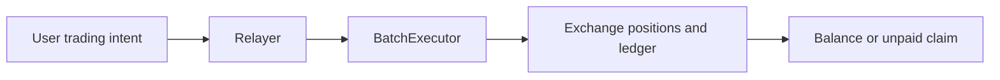

# Papertrade Mechanics Lab

**Research into Papertrade trading, settlement and PAPER issuance.**

An independent open-source project that studies official documentation, public
frontend definitions, historical contract bytecode, transaction inputs and events.
We turn observable rules into explanations with evidence and version boundaries:
how a trade executes, how its result becomes a balance or unpaid claim, and how
PAPER is issued.

[简体中文](README.zh-CN.md) · [Mechanism map](docs/mechanism-map.md) · [Research notes](docs/research-notes/003-historical-interface-recovery.md) · [Sources](docs/sources.md)

## How does Papertrade work?

The explanations below distinguish **official descriptions** from **observed
on-chain structure**. The documented economic rules have not yet passed an
independent settlement replay. Current descriptions and individual block snapshots
do not establish behavior for every historical trade.

### From intent to contract execution

The official architecture sends signed user intents through a relayer and a
BatchExecutor to Exchange. Intent acceptance, transaction inclusion and success
of an individual call are separate stages. Waiting for execution is also distinct
from waiting for a payout. See the [architecture source](https://docs.papertrade.xyz/how/architecture/).

This is the documented path. In one historical candidate, we observed a close
call within a batch whose position ID matches the close event. Complete intent
authorization and economic results still require further evidence.

### Positions and account balances have separate records

In the inspected historical implementation, bytecode exposes positions by ID
and a separate balance mapping. The first candidate's close input specifies one
position, whose record remains readable at block end. This helps distinguish a
position result from an aggregate account change; business field meanings and
execution pre-state still need verification. See the [historical interface and
storage note](docs/research-notes/003-historical-interface-recovery.md).

### A winning payout is not a flat percentage deduction

The official description applies a deadband and nonlinear gain adjustment before
a fee on the adjusted gain. Its `10%` launch parameter does not mean every winning
trade loses exactly `10%`; the described `2%` fee has its own basis. Explaining a
payout requires separating price movement, adjusted PnL, fees, returned margin
and spendable balance. See the [payout research note](docs/research-notes/001-winning-trade-payout.md).

### Cash, claims and the payout queue are different accounting states

The official solvency description separates available cash from unpaid claims,
with queued payment when funds are insufficient and distinct claim-funded trading
branches. An entitlement and an amount available to withdraw are different
measurements. Ledger and later events are needed to establish payment; an eventual
payment description is not a fixed deadline. See the [solvency source](https://docs.papertrade.xyz/how/solvency-queue/).

### PAPER issuance depends on eligible losses and curve state

The official mint description relates issuance to eligible loss, tracked LP and
high-water progress. A marginal rate at one instant differs from the average rate
across a loss interval. Comparing tokens per unit lost therefore requires the
eligible basis, interval and units, rather than two displayed numbers alone.
See the [mint-curve source](https://docs.papertrade.xyz/how/mint-curve/).

### Directional limits and liquidation have separate conditions

Official risk documentation describes directional open-interest capacity, market
gates, leverage and position limits. Interface restrictions, relayer admission
and contract checks are separate layers. Explaining a historical one-sided
rejection still needs contemporaneous parameters, state and error evidence.
See the [risk source](https://docs.papertrade.xyz/how/risk/) and [mechanism map](docs/mechanism-map.md).

---

Research is read-only; this project does not operate wallets or submit trades.
It is unofficial. Original code and documentation use [Apache-2.0](LICENSE).
[Method](docs/research-method.md) · [Evidence and progress](STATUS.md) · [Contributing and disclosure](CONTRIBUTING.md) · [Third-party notices](THIRD_PARTY_NOTICES.md)
