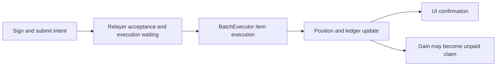

# Papertrade Mechanics Lab

**Research into Papertrade trading, settlement and PAPER issuance.**

An independent open-source project reading official sources, inspecting frontend
and contract bytecode, and checking public transaction events. We explain how trades
execute, losses mint PAPER, rewards are allocated, and balances differ from unpaid claims.

[简体中文](README.zh-CN.md) · [Mechanism map](docs/mechanism-map.md) · [Latest mechanism research](docs/research-notes/008-core-credit-and-relayer-pressure.md) · [Sources](docs/sources.md)

We distinguish **official description, bytecode support, chain case support, and
independent reproduction passed**. Some paths now have bytecode and provider-reported
case support; complete historical settlement has not passed independent reproduction.
Rules and parameters need version-specific checks.

## Why do opens and closes wait?

**The current frontend has an intent queue state and rank display; server scheduling,
priority and actual waiting times remain unverified.** Official architecture routes
opens/closes through the relayer and BatchExecutor. An acknowledgement produces
`queued`; an uncertain acknowledgement retains `unconfirmed`. With queued operations,
the UI polls ranks every two seconds. That is a polling interval, not an execution
deadline. A successful batch transaction still requires checking each item's result.



**Execution waiting and payout waiting are separate.** The documented payout queue
holds unpaid claims in FIFO order and pays them through available backing and later
harvests. Cash-funded returned margin is credited separately from unpaid gains;
claim-funded collateral was already debt, so the whole surviving claim may queue
again. A payout queue does not itself halt all opens: balances, directional capacity
and debt-processing limits still apply. We have no complete user submit/ack/broadcast
execution timeline or independently reconstructed active payout-queue ledger.

**Real batch checks:** the retained window has 438 batches and 734 item results:
730 successes and four failures. All four failures occur in one six-open batch,
ordered success/failure/failure/failure/failure/success. The error selector maps
to the acquired runtime's directional-cap check, and failures did not abort that
batch. Submitted array order is supported; cross-user relayer FIFO is not.

**Real backend backlog is now observed.** The official anonymous feed labels its
source `relayer-postgres`. Twelve sampled snapshots report **159–217 queued intents**
and **0–59 submitted intents**. One has **217 queued and 0% saturation**: in this
sample, saturation tracks submitted gas divided by block gas limit, not an empty
queue or a waiting-time estimate. These are aggregate counts across actions, not
open/close-only counts. Cross-user FIFO, priority and retries remain unverified.

Current open/close signatures default to a one-hour deadline, which is not a fill promise.
The client filters IDs already being closed and submits closes in groups of up to 12.

**Evidence: official description and frontend source; batch events support individual
success/failure outcomes.** [Real backend pressure and metric limits](docs/research-notes/008-core-credit-and-relayer-pressure.md#real-backend-observation-anonymous-relayer-pressure) ·
[Batch and client rules](docs/research-notes/007-queue-and-dividend-payment.md#execution-array-order-and-partial-failures-are-real-scheduler-fifo-is-unknown) ·
[Architecture](https://docs.papertrade.xyz/how/architecture/) · [Payout queue](https://docs.papertrade.xyz/how/solvency-queue/)

## How do positions work? Can one account hold both long and short?

Papertrade offers synthetic leveraged positions against its LP, referencing
Hyperliquid prices. Documented positions are isolated: margin and leverage are fixed
at open, with no increase to an existing position, collateral top-up or partial close.
Additional exposure requires another position; each closes in full. Documentation
lists BTC/ETH and up to 1000× leverage; deployed parameters govern actual limits.

**The current official app has no limit, take-profit, stop-loss or other scheduled/conditional orders.**
The owner's operation observation is supported by the fetched trade form and signed
schemas: opens specify market, side, margin and leverage; closes specify position IDs.
There is no limit/trigger-price field in those inspected paths. Queuing waits for
intent execution, not a user-selected target price. This conclusion is scoped to
the inspected current official app.

**A sampled chain case supports simultaneous opposite positions on the same account
and market.** The first selected pair has distinct IDs, opposite sides, equal entry
and margin, and no known ending of the first before the second opens. Inputs match
event fields. This supports coexistence without establishing universal admission
across all accounts, directional caps or relayer states. Each leg consumes its own
margin and side capacity; isolated positions do not cross-collateralize each other.

**Economics are calculated per leg.** The winner faces deadband, gain adjustment
and fees; the loser bears its realized loss, with PAPER accounted separately. The
selected pair's eventual close events imply combined trading PnL of about
**−0.223207 internal accounting units**, plus about **3.421797 PAPER** minted on the
losing leg. This is not a complete account balance delta and assigns no collateral
value to PAPER. Double-leg liquidation and claim-funded combinations remain unverified.

**Evidence: bytecode support and chain case support; no complete historical replay.**
[Opposite-position case](docs/research-notes/006-current-mechanisms.md#case-005-opposite-positions-can-coexist-in-the-observed-case) ·
[Position rules](https://docs.papertrade.xyz/learn/trades-pricing/)

## Why is credited profit smaller?

A winning close applies a deadband, nonlinear gain adjustment, then a fee on adjusted
gain. A documented launch parameter of `10%` does not mean every winner loses a flat
`10%`; the described `2%` fee has its own basis. We recovered staged integer arithmetic
for one winning branch and matched CASE-001 candidate 4's amounts. Its historical
parameters and actual price inputs remain missing, so this is same-case consistency.

**Evidence: official description and partial bytecode support.** [Profit research](docs/research-notes/004-economic-path-and-state-audit.md)

## How do losses and liquidations mint PAPER?

**A losing close and a liquidation can have different mint bases. Multiplying loss
by the currently displayed emission rate is insufficient.**

| Documented branch | PAPER basis and cash routing |
|---|---|
| Cash-funded losing close, empty payout queue | Loss less any charged LP-side loss fee; that fee is not an additional trader deduction. |
| Cash-funded losing close, active queue | Full loss; fee waived, with sideBucket backing prioritized for queued payouts. |
| Cash-funded liquidation | Full lost margin; tracked LP can advance by margin less fee, so the two bases differ. |
| Claim-funded loss / liquidation | Destroyed claim, accounting for an applicable loss-close fee; full destroyed margin and no liquidation fee on debt liquidation. |

One reviewed loss has a mint basis matching loss less fee. A reviewed liquidation
uses **20** as its full-margin basis while tracked LP advances **19.6** and fees total
**0.4**. Both PAPER mint Transfers match tokenomics event amounts. Claim-funded and
active-queue branches remain primarily official descriptions without real-case replay.

The curve has a flat region followed by decay. This round's documentation and
parameter responses give a **$2M** flat threshold, **100 PAPER per unit of eligible
basis**, and **$120M** tail scale. The tail marginal rate is
`100 × (S / (S + H))²`, with H the accumulated tail progress. Actual issuance integrates
over the loss interval with staged integer rounding. A displayed marginal rate is
not the whole trade's average rate. Distributing LP excess to stakers does not reset
H; re-entering the tail uses retained progress. These acquisition-time parameters
are not historical inputs for old transactions.

**Evidence: official description, bytecode support and two matching mint receipts;
independent historical expected mint remains missing.**
[Bases, integer formula and cases](docs/research-notes/006-current-mechanisms.md#case-003-loss-basis-liquidation-basis-and-the-mint-curve) ·
[Official mint curve](https://docs.papertrade.xyz/how/mint-curve/)

## Where do PAPER dividends come from, and how are they claimed?

**The documented entitlement requires staking PAPER; holding alone is insufficient.**
The two stated sources are half of paid trading fees and sweepable tracked-LP excess
above the currently described **$5M cap**. Queue and solvency conditions govern fee
payment, so a nominal fee is not automatically an immediate dividend.

`Exchange fee/excess accumulation → push → signed distribution → per-stake accrual → claim to trading balance → withdrawal action → verify final credit`

The acquired staking runtime uses a **10^27 accumulator**, combining stored rewards,
stake, accumulator and reward debt. With zero stake, newly received funds remain
unallocated; unstaking preserves previously accrued rewards. Documentation describes
no lockup/cooldown, while app stake, unstake and claim still use signatures and the
relayer and can wait for execution. The reviewed stake matches a PAPER transfer in;
the reviewed claim matches an Exchange credit event. External withdrawal is another
step. The initial window has no distribution event; a separately registered targeted
block then matched about **131.938049** in fee push and distribution amounts. Exact
pre-distribution shares, LP-excess funding and real unstake remain unreproduced.

A follow-up real claim of about **1115.251243442** exactly matches internal balance
credit. The same chain account later executes a withdrawal of about **1115.251244**,
with an Exchange-to-recipient CoreWriter spot-send action in its receipt. **A later
official HyperCore ledger query found one exact incoming match: 1115.251244 USDC,
with sender, recipient and amount reconciled to that action.** This case is checked
through HyperCore account credit; it is not a universal withdrawal guarantee or
independent consensus replay. This shared-balance withdrawal differs slightly from the claim and
cannot be wholly attributed to that dividend. An onward route to another chain
requires a separate destination receipt.

**Evidence: official description, bytecode support and stake/claim/withdrawal cases;
the selected withdrawal passes official HyperCore credit reconciliation.**
[HyperCore credit confirmation and limits](docs/research-notes/008-core-credit-and-relayer-pressure.md#selected-withdrawal-one-exact-official-ledger-match) ·
[Accumulator and distribution](docs/research-notes/006-current-mechanisms.md#case-004-dividends-are-an-accumulator-and-a-claim-against-internal-balance) ·
[Official staking mechanics](https://docs.papertrade.xyz/paper/staking/)

## How are liquidation triggers and losses calculated?

**The acquired runtime applies a buffer to the trigger and hard-liquidates the full
isolated margin.** Positive remaining voluntary-close equity does not prevent a
liquidation trigger. For the recovered path, with entry E, integer leverage l and
W-scaled buffer b (`W = 10^18`):

```text
d = floor(E / l)
long:  z = E - d; bust = z + floor(z * b / W)
short: z = E + d; bust = z - floor(z * b / W)
```

The buffer applies to zero-equity reference z, preserving both rounding stages.
The price gate is inclusive: **price ≤ bust for longs; price ≥ bust for shorts**.
The live-BBO versus retired/frozen-price path must also be checked. Synthetic inputs
cover either side of the threshold and equality; they do not authenticate historical
bid/ask values.

Documentation describes an operated keeper and public liquidation maintenance.
A successful close or liquidation clears the position's open flag, guarding later
repeated attempts. A waiting close intent does not itself protect the position from
liquidation. Keeper priority descriptions do not guarantee actual transaction order.
Full-margin loss, mint basis and fee routing must be reconciled together.

**Evidence: bytecode support and one liquidation chain case; real races and complete
historical settlement remain unreproduced.**
[Exact formula and boundaries](docs/research-notes/006-current-mechanisms.md#liquidation-exact-buffer-basis-and-inclusive-threshold) ·
[Official liquidation description](https://docs.papertrade.xyz/learn/liquidations/)

---

Research is read-only; this project does not operate wallets or submit trades.
It is unofficial. Original code and documentation use [Apache-2.0](LICENSE).
[Evidence and progress](STATUS.md) · [Method](docs/research-method.md) · [Contributing and data boundaries](CONTRIBUTING.md) · [Third-party notices](THIRD_PARTY_NOTICES.md)
