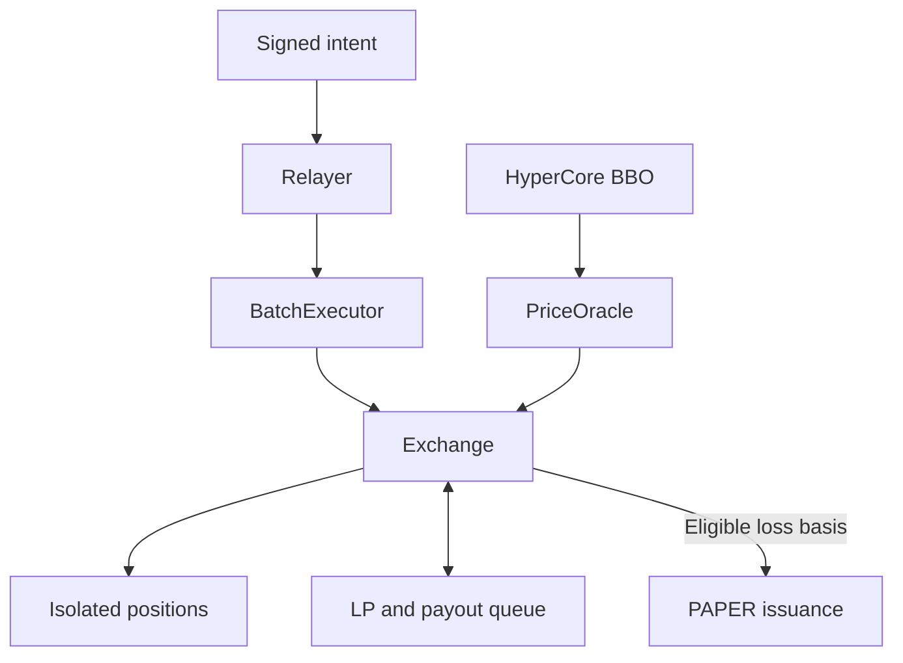
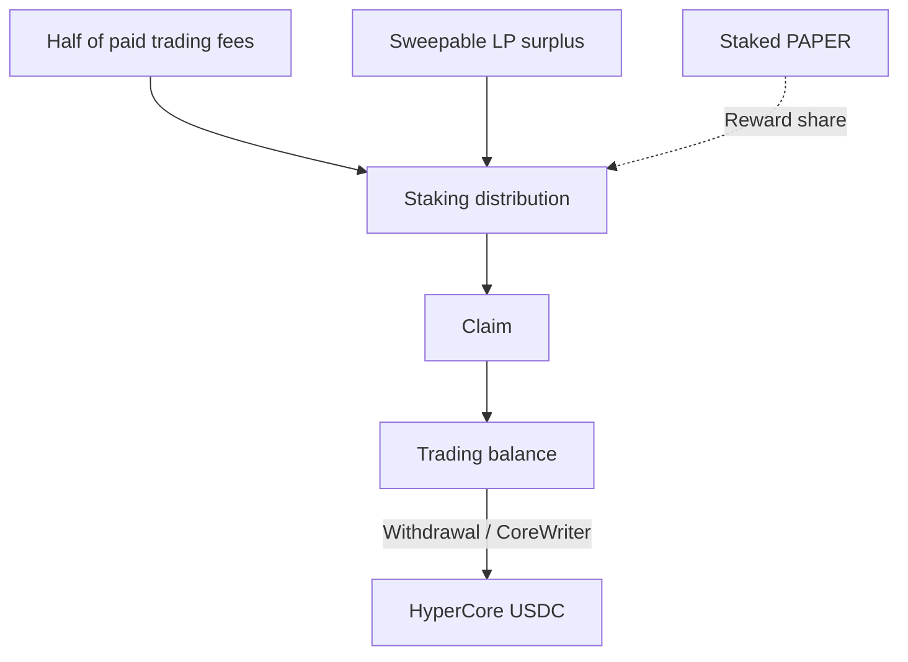

<h1 align="center">Papertrade Mechanics Lab</h1>

<p align="center">
  <strong>Inside 1000× perpetuals, loss-to-PAPER emissions, and staking dividends.</strong>
</p>


<p align="center">
  <a href="https://docs.papertrade.xyz/"></a>
  <a href="STATUS.md"></a>
  <a href="LICENSE"></a>
</p>

<p align="center">
  <a href="README.zh-CN.md">简体中文</a> ·
  <a href="#mechanisms-at-a-glance">Mechanisms</a> ·
  <a href="#follow-the-evidence">Research</a> ·
  <a href="#explore-the-lab">Explore the lab</a> ·
  <a href="docs/sources.md">Sources</a>
</p>

[Papertrade](https://docs.papertrade.xyz/) is a HyperEVM perpetuals protocol with up to
**1000× leverage**. Traders settle against its liquidity pool; realized losses mint
**PAPER**, which can be staked for dividends from paid trading fees and LP surplus.

This independent lab explains those mechanics through frontend and bytecode analysis,
public transaction cases, and reproducible research tools.

## Mechanisms at a glance

| Mechanism | What happens | Read more |
|---|---|---|
| **Execution** | Signed intents wait at the relayer, then execute as individual items in a batch. | [Queue & batch behavior](docs/research-notes/007-queue-and-dividend-payment.md) |
| **Positions** | Isolated margin, fixed leverage and full closure per position. Separate long and short positions can coexist. | [Position case](docs/research-notes/006-current-mechanisms.md#case-005-opposite-positions-can-coexist-in-the-observed-case) |
| **Settlement** | Winning gains pass through a deadband, nonlinear adjustment and fee. Unpaid payouts enter a separate queue. | [PnL & integer arithmetic](docs/research-notes/004-economic-path-and-state-audit.md) |
| **PAPER & dividends** | Eligible losses mint PAPER along a decaying curve. Staked PAPER earns allocated rewards. | [Minting & staking](docs/research-notes/006-current-mechanisms.md) |
| **Liquidation** | A buffered bust threshold triggers loss of the position's full isolated margin. | [Triggers & rounding](docs/research-notes/006-current-mechanisms.md#liquidation-exact-buffer-basis-and-inclusive-threshold) |

The current official app uses market execution; it has no limit, take-profit or stop-loss orders.

## From intent to settlement



| Two different queues | What is waiting? | What moves it forward? |
|---|---|---|
| **Execution queue** | A signed action awaiting processing | Relayer selection, submission and successful item execution |
| **Payout queue** | An unpaid settlement claim | Available backing and harvest; documented FIFO payouts |

## From PAPER to dividends

**Stake PAPER → accrue rewards → claim into the trading balance → withdraw to HyperCore.**



Holding PAPER alone does not earn dividends. The documented reward sources are half
of paid trading fees and sweepable LP excess above the configured LP cap.

## Follow the evidence

| Question | Result from sampled cases | Research |
|---|---|---|
| Does a successful batch mean every item succeeded? | **734 results:** 730 successes, 4 failures; later items still executed after failures. | [007 · Batch outcomes](docs/research-notes/007-queue-and-dividend-payment.md) |
| Does 0% saturation mean no backlog? | A service snapshot reports **217 queued intents at 0% saturation**. | [008 · Relayer pressure](docs/research-notes/008-core-credit-and-relayer-pressure.md) |
| Can opposite positions cost money together? | One closed pair reports **−0.223207** trading PnL in internal units, plus **3.421797 PAPER** on the losing leg. | [006 · Opposite positions](docs/research-notes/006-current-mechanisms.md#case-005-opposite-positions-can-coexist-in-the-observed-case) |
| Can dividend reserve movements be reconciled? | **3 distributions and 33 later claims** reconcile to the captured API reserve. | [009 · Latest: reserve ledger](docs/research-notes/009-distribution-reserve-ledger.md) |
| Did a selected withdrawal reach HyperCore? | **1115.251244 USDC** matches the official incoming ledger entry. | [008 · Credit confirmation](docs/research-notes/008-core-credit-and-relayer-pressure.md#selected-withdrawal-one-exact-official-ledger-match) |

**Evidence status:** findings combine official descriptions, acquired code and sampled
provider-reported events. Full historical replay, backend scheduling policy and
LP-surplus/debt cases remain open. [Verification & progress →](STATUS.md)

## Explore the lab

| Start here | What you will find |
|---|---|
| [Mechanism map](docs/mechanism-map.md) | A guide to the protocol's 14 research areas |
| [Research notes](docs/research-notes/) · [Case records](research/cases/) | Explanations, source coordinates and structured outcomes |
| [Offline arithmetic](packages/research/mechanics.ts) | Mint-curve, bust-price and pending-reward helpers |
| [Evidence tooling](docs/chain-evidence.md) | Record validation and version consistency |
| [Collection](docs/readonly-collection.md) · [Safe export](docs/safe-export.md) | Bounded public reads and reviewed metadata export |
| [Method](docs/research-method.md) · [Roadmap](ROADMAP.md) | Research process and next milestones |

<details>
<summary><strong>Run the local checks</strong> · Node.js ≥ 24.12.0 / pnpm 11.25.0</summary>

```sh
pnpm install --frozen-lockfile
pnpm test
pnpm typecheck
pnpm validate:records
```

Tests and validation run locally. Live collection is an explicit, separate command.

</details>

---

[Contribute](CONTRIBUTING.md) · [Data policy](DATA_POLICY.md) · [Apache-2.0](LICENSE) · [Third-party notices](THIRD_PARTY_NOTICES.md)
