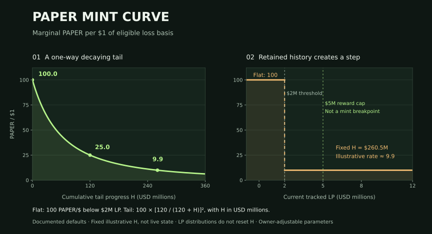
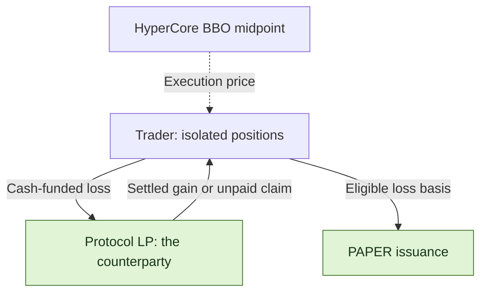
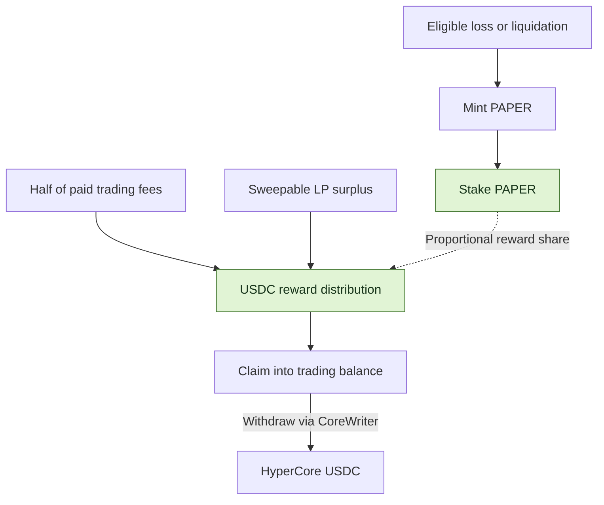
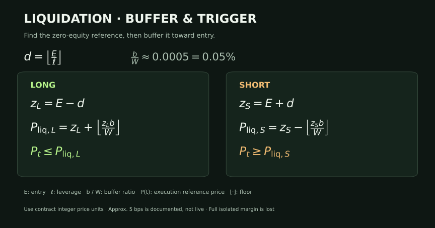

<h1 align="center">papertrade-research</h1>

<p align="center">
  <strong>Papertrade mechanics: trading, liquidation and PAPER dividends.</strong>
</p>


<p align="center">
  <a href="docs/mechanism-map.md"></a>
  <a href="STATUS.md"></a>
  <a href="LICENSE"></a>
</p>

<p align="center">
  <a href="README.zh-CN.md">中文</a> ｜ <strong>English</strong>
</p>

<p align="center">
  <a href="#features">Features</a> ·
  <a href="#paper-mint-curve">Mint curve</a> ·
  <a href="#trading-costs">Fees</a> ·
  <a href="#paper-the-dividend-token">PAPER</a> ·
  <a href="#explore-the-research">Explore the research</a> ·
  <a href="docs/sources.md">Sources</a>
</p>

[Papertrade](https://docs.papertrade.xyz/) is a perpetuals protocol on HyperEVM: trades settle against the protocol LP, losses can generate PAPER, and staked PAPER participates in USDC distributions.

🔎 This repository examines its fees, liquidation rules and the link between losses and PAPER incentives. [Research status](STATUS.md) · [Sources](docs/sources.md)

## Features

| Feature | How it works |
|---|---|
| 🤝 **Protocol LP as counterparty** | Every trade settles directly with the Papertrade protocol liquidity pool, which takes the other side of trader PnL. |
| 📊 **Hyperliquid pricing** | Contracts read the HyperCore best-bid/ask midpoint; accounting and settlement run on HyperEVM. |
| ⚡ **Up to 1000×, isolated margin** | Margin and leverage are fixed at open. Each position closes in full; long and short positions are independent. |
| 💸 **0 opening fee · 0 funding payments** | Profitable closes incur gain adjustment and fees. The relayer pays gas for relayed trades. |
| ⏳ **Queues during busy periods** | The relayer receives, queues and batches market intents on chain. Both opens and closes can wait. |
| 🪙 **Losses generate PAPER** | Eligible losses and liquidations mint PAPER along the emission curve; staked PAPER shares participate in USDC distributions. |

> 🖥️ <strong>Manual monitoring required:</strong> The current product has web-based market orders, without limit orders, automatic take-profit/stop-loss or a standalone mobile app.
> At high leverage, a small adverse move can liquidate a position. Controlling exit timing requires watching prices and closing manually; liquidation can still precede a queued close.

🧩 <strong>The mechanism to examine:</strong> A losing close or liquidation generates PAPER from eligible loss basis; staking PAPER then participates in distributions. Liquidation risk and post-loss token incentives sit inside the same system.

[Trading mechanics](docs/mechanism-map.md)

## PAPER mint curve



- 📉 <strong>How it decays:</strong> Documented examples use 100 PAPER/$ below $2M LP; at or above the threshold, the rate falls with cumulative tail progress H.
- ⚙️ <strong>Who can change it:</strong> The contract owner can adjust the LP threshold, mint rate, decay scale and LP reward cap.

H is cumulative progress; LP distributions do not reset it. The right panel fixes H to show the threshold step using example parameters. Whole-trade minting integrates over an interval.
[Formula and figure inputs](docs/readme-figures.md#mint-rate-illustration) · [Parameter authority](docs/readme-figures.md#parameter-authority)

## Trading costs

| When | What the trader pays |
|---|---|
| **Open a position** | 0 opening fee |
| **Keep a position open** | 0 funding payments |
| **Execute a relayed trade** | Gas is paid by the relayer |
| **Close at a profit** | Deduct deadband, adjust the gain, then charge **2% of adjusted profit** |
| **Close at a loss** | The realized loss, with no extra trading fee |

💡 The deadband is approximately <strong>0.002%</strong> of entry price. In the documented examples, the nonlinear adjustment removes about <strong>10% to nearly 100%</strong> of the post-deadband gain; smaller favorable price moves lose more.
The final 2% applies to adjusted profit, not position notional.

[Gain formula and BTC/ETH examples](docs/readme-figures.md#profit-retention-examples)

## Who pays whom?



| Two separate waits | What is waiting? |
|---|---|
| **Execution queue** | An open or close intent waiting for relayer selection and successful execution. |
| **Payout queue** | A settled claim waiting for available LP backing and harvest; the documented payout order is FIFO. |

With cash-funded positions, returned margin is credited separately from unpaid gains.
Debt-funded losses cancel the corresponding claim rather than bring in new cash.
[Execution queue and payout mechanics](docs/research-notes/007-queue-and-dividend-payment.md)

## PAPER: the dividend token

🪙 Eligible loss basis drives PAPER issuance; trading fees and LP surplus fund USDC distributions.



| Step | Rule |
|---|---|
| 🪙 **Minting** | Eligible loss basis and curve progress determine the amount. |
| 📥 **Staking** | Distributions accrue by staked share; holding alone does not participate. No documented lockup or cooldown. |
| 💵 **Funding** | Half of paid trading fees, plus sweepable tracked-LP excess above the cap; the documented example cap is $5M. |
| ↗️ **Claiming** | Claim into trading balance, then withdraw separately to HyperCore. |

[Mint curve & staking analysis](docs/research-notes/006-current-mechanisms.md) · [Dividend payment path](docs/research-notes/007-queue-and-dividend-payment.md)

## Liquidation: trigger price and margin loss

⚠️ Liquidation triggers before the theoretical zero-equity price. The documented buffer is about 5 basis points (0.05%), applied to that reference. Liquidation consumes the full isolated margin.



> 🧮 <strong>Illustrative 100× long:</strong> entry 100 → zero-equity price 99 → liquidation price about 99.0495 ≈ 99.05.
> A voluntary close before the trigger can return remaining equity; liquidation consumes the full margin.

Higher leverage makes the buffer a larger fraction of margin. See [formula and rounding](docs/research-notes/006-current-mechanisms.md#liquidation-exact-buffer-basis-and-inclusive-threshold).

## Explore the research

| Start here | What you will find |
|---|---|
| [Mechanism map](docs/mechanism-map.md) | A guide to the protocol's 14 research areas |
| [Research notes](docs/research-notes/) · [Case records](research/cases/) | Explanations, source coordinates and structured outcomes |
| [Offline arithmetic](packages/research/mechanics.ts) | Mint-curve, bust-price and pending-reward helpers |
| [Evidence tooling](docs/chain-evidence.md) | Record validation and version consistency |
| [Collection](docs/readonly-collection.md) · [Safe export](docs/safe-export.md) | Bounded public reads and reviewed metadata export |
| [Method](docs/research-method.md) · [Progress](STATUS.md) · [Roadmap](ROADMAP.md) | Research process, verification status and next milestones |

<details>
<summary><strong>Run the local checks</strong> · Node.js ≥ 24.12.0 / pnpm 11.25.0</summary>

```sh
pnpm install --frozen-lockfile
pnpm test
pnpm typecheck
pnpm validate:records
```

Tests and validation run locally. Live collection is an explicit, separate command.

</details>

---

[Contribute](CONTRIBUTING.md) · [Data policy](DATA_POLICY.md) · [Apache-2.0](LICENSE) · [Third-party notices](THIRD_PARTY_NOTICES.md)
