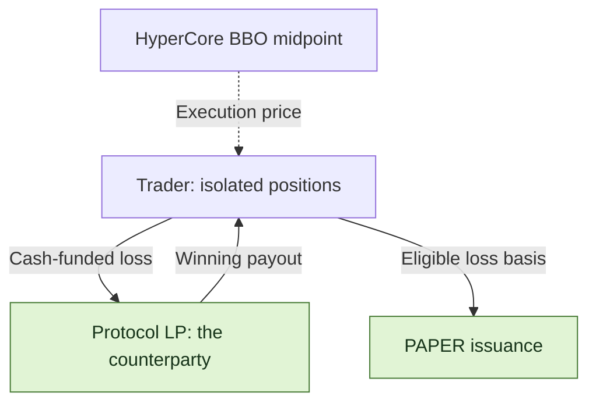
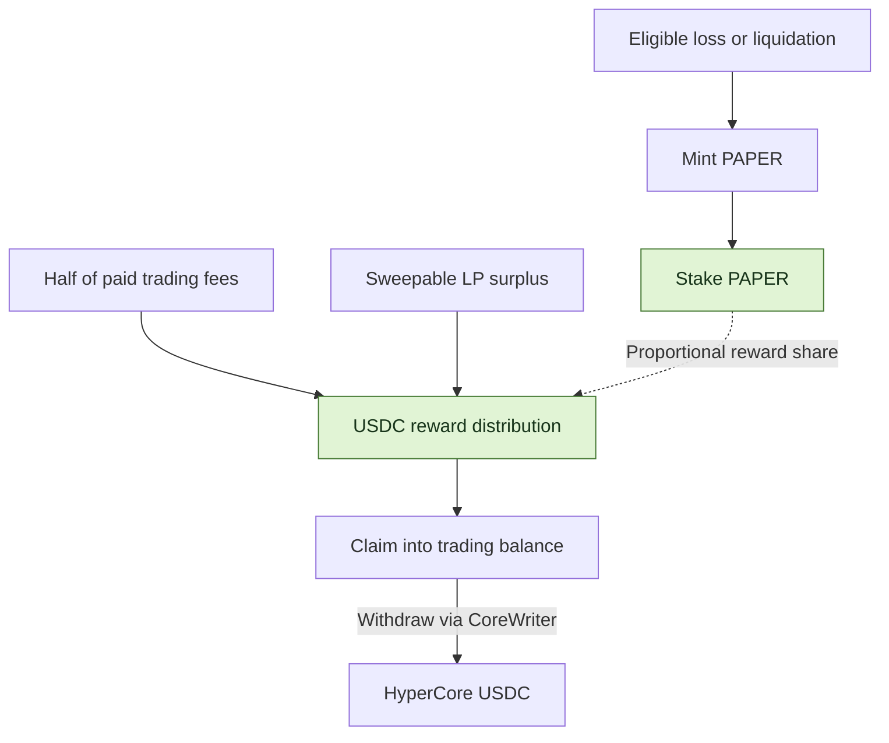

<h1 align="center">papertrade-research</h1>

<p align="center">
  <strong>Inside 1000× perpetuals, loss-to-PAPER emissions, and staking dividends.</strong>
</p>


<p align="center">
  <a href="docs/mechanism-map.md"></a>
  <a href="STATUS.md"></a>
  <a href="LICENSE"></a>
</p>

<p align="center">
  <a href="README.zh-CN.md">中文</a> ｜ <strong>English</strong>
</p>

<p align="center">
  <a href="#features">Features</a> ·
  <a href="#paper-mint-curve">Mint curve</a> ·
  <a href="#trading-costs">Fees</a> ·
  <a href="#paper-the-dividend-token">PAPER</a> ·
  <a href="#explore-the-research">Explore the research</a> ·
  <a href="docs/sources.md">Sources</a>
</p>

[Papertrade](https://docs.papertrade.xyz/) is a HyperEVM perpetuals protocol with up to
**1000× leverage**. Traders settle against its liquidity pool; realized losses mint
**PAPER**, which can be staked for dividends from paid trading fees and LP surplus.

🔎 This independent research project explains those mechanics through frontend and bytecode analysis,
public transaction cases, and reproducible research tools.

## Features

| Feature | How Papertrade works |
|---|---|
| 🤝 **Settle with the PaperTrade LP** | Every trade settles directly with the PaperTrade protocol liquidity pool, which takes the other side of the PnL. |
| 📊 **Hyperliquid prices, HyperEVM settlement** | Contracts read the HyperCore best-bid/ask midpoint. Positions and balances live on HyperEVM. |
| ⚡ **Up to 1000×, isolated per position** | Margin and leverage are fixed at open; each position closes in full. Separate long and short positions can coexist. |
| 💸 **No opening fee or funding payments** | The trader's protocol charges come from profitable closes. The relayer pays gas for relayed trades. |
| ⏳ **Watch the queue during busy periods** | The relayer receives, queues and batches market intents on chain. Opens and closes can wait, especially during busy periods; liquidation can beat a queued close. |
| 🪙 **Losses earn PAPER** | Eligible realized losses and liquidations mint PAPER along a decaying emission curve. Staking PAPER earns a share of USDC distributions. |

The current official product is <strong>web-based</strong>, with no standalone mobile app. It supports market orders only, without limit orders or automatic take-profit/stop-loss.
Settlement uses the BBO midpoint at execution, without order-book-depth slippage. The reference price can still change while an intent waits.

> 🖥️ <strong>A friendly reminder:</strong> Papertrade currently offers web-based market orders without automatic take-profit/stop-loss. Actively managing a position means staying with the page, watching prices and closing manually.
> This setup suits people with plenty of time who can stay at their computer xD.

[Trading mechanics →](docs/mechanism-map.md)

## PAPER mint curve


Below the documented <strong>$2M tracked-LP threshold</strong>, the flat region mints <strong>100 PAPER per $1 of eligible loss basis</strong>.
At or above the threshold, the marginal rate is `r(H) = R × [S / (S + H)]²`, with documented examples `R = 100`, `S = $120M`, and cumulative tail progress `H`.

<strong>Current LP and H are different variables.</strong> Distributions reduce LP without resetting H. The right panel fixes retained `H = $260.5M`, giving about <strong>9.9 PAPER/$</strong>,
to illustrate the threshold step rather than a live point. Whole-trade issuance integrates over its interval; it is not simply loss times the displayed marginal rate.

⚙️ <strong>Parameters are adjustable:</strong> the contract owner can change the LP threshold, flat mint rate, decay scale and LP reward cap.
[Mint formula and figure inputs](docs/readme-figures.md#mint-rate-illustration) · [Parameter authority](docs/readme-figures.md#parameter-authority)

## Trading costs

| When | What the trader pays |
|---|---|
| **Open a position** | **0 opening fee** |
| **Keep a position open** | **0 funding payments** |
| **Execute a relayed trade** | Gas is paid by the relayer |
| **Close at a profit** | Deduct deadband, adjust the gain, then charge **2% of adjusted profit** |
| **Close at a loss** | The realized loss, with no extra trading fee |

💡 The deadband is approximately <strong>0.002%</strong> of entry price. In the documented examples, the nonlinear adjustment removes about <strong>10% to nearly 100%</strong> of the post-deadband gain; smaller favorable price moves lose more.
The final 2% applies to adjusted profit, not position notional.

[See the gain formula and BTC/ETH examples →](docs/readme-figures.md#profit-retention-examples)

## Who pays whom?



| Two separate waits | What is waiting? |
|---|---|
| **Execution queue** | An open or close intent waiting for relayer selection and successful execution. |
| **Payout queue** | A settled claim waiting for available LP backing and harvest; the documented payout order is FIFO. |

With cash-funded positions, returned margin is credited separately from unpaid gains.
Debt-funded losses cancel the corresponding claim rather than bring in new cash.
[Execution queue and payout mechanics](docs/research-notes/007-queue-and-dividend-payment.md)

## PAPER: the dividend token

**Losses mint it. Staking activates the reward share. Distributions pay in USDC.**



| PAPER feature | What it means |
|---|---|
| **Earned through losses** | Emissions follow eligible loss basis and curve progress; PAPER per dollar is not fixed. |
| 📥 **Stake to participate** | Holding alone does not earn dividends. Rewards accrue by staked share, with no documented lockup or cooldown. |
| 💵 **Two reward sources** | Half of paid trading fees, plus sweepable tracked-LP excess above its configured cap, documented at **$5M**. |
| ↗️ **Claim, then withdraw** | Claiming credits the trading balance. Moving USDC to HyperCore is a separate withdrawal. |

[Mint curve & staking analysis](docs/research-notes/006-current-mechanisms.md) · [Dividend payment path](docs/research-notes/007-queue-and-dividend-payment.md)

## Liquidation: the buffer matters

Liquidation triggers **before the theoretical zero-equity price**. The documented
buffer is about **5 basis points (0.05% of price)** toward entry. This is a price
buffer, not a promise to return the remaining margin: triggering liquidation
consumes the position's **full isolated margin**.

> <strong>Illustrative 100× long:</strong> entry 100 → theoretical zero-equity price 99 →
> liquidation trigger about **99.05**. A voluntary close just before the trigger
> can still return equity; liquidation at the trigger consumes the whole margin.


The buffer applies to the zero-equity reference price. At entry 100, 100× leverage and a 0.05% buffer, the continuous long-side result is **99.0495 ≈ 99.05**; the contract rounds in integer price units.
Higher leverage makes the same small price buffer a larger fraction of margin.
[Exact formula & rounding](docs/research-notes/006-current-mechanisms.md#liquidation-exact-buffer-basis-and-inclusive-threshold)

## Explore the research

| Start here | What you will find |
|---|---|
| [Mechanism map](docs/mechanism-map.md) | A guide to the protocol's 14 research areas |
| [Research notes](docs/research-notes/) · [Case records](research/cases/) | Explanations, source coordinates and structured outcomes |
| [Offline arithmetic](packages/research/mechanics.ts) | Mint-curve, bust-price and pending-reward helpers |
| [Evidence tooling](docs/chain-evidence.md) | Record validation and version consistency |
| [Collection](docs/readonly-collection.md) · [Safe export](docs/safe-export.md) | Bounded public reads and reviewed metadata export |
| [Method](docs/research-method.md) · [Progress](STATUS.md) · [Roadmap](ROADMAP.md) | Research process, verification status and next milestones |

<details>
<summary><strong>Run the local checks</strong> · Node.js ≥ 24.12.0 / pnpm 11.25.0</summary>

```sh
pnpm install --frozen-lockfile
pnpm test
pnpm typecheck
pnpm validate:records
```

Tests and validation run locally. Live collection is an explicit, separate command.

</details>

---

[Contribute](CONTRIBUTING.md) · [Data policy](DATA_POLICY.md) · [Apache-2.0](LICENSE) · [Third-party notices](THIRD_PARTY_NOTICES.md)
