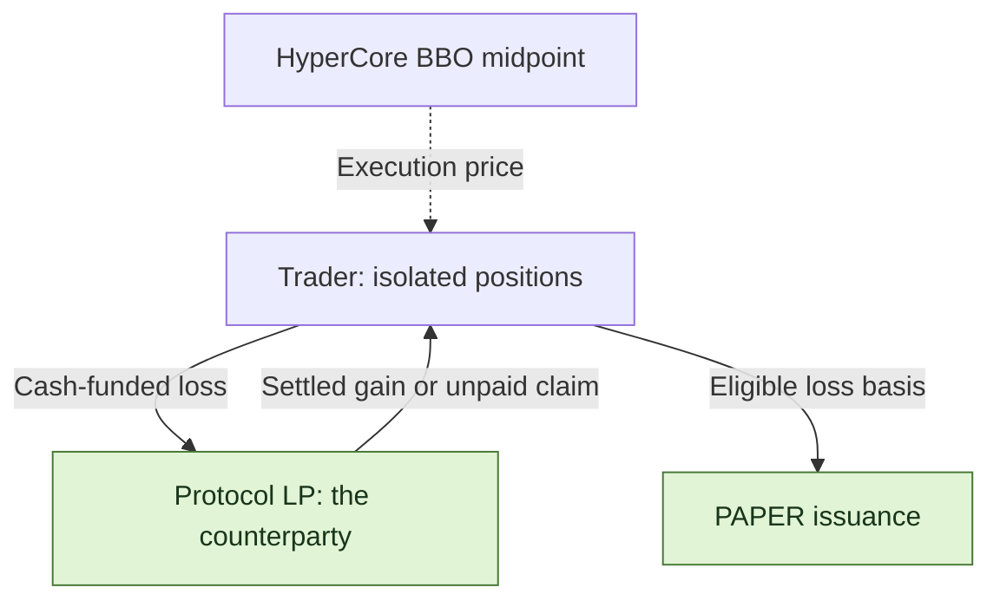
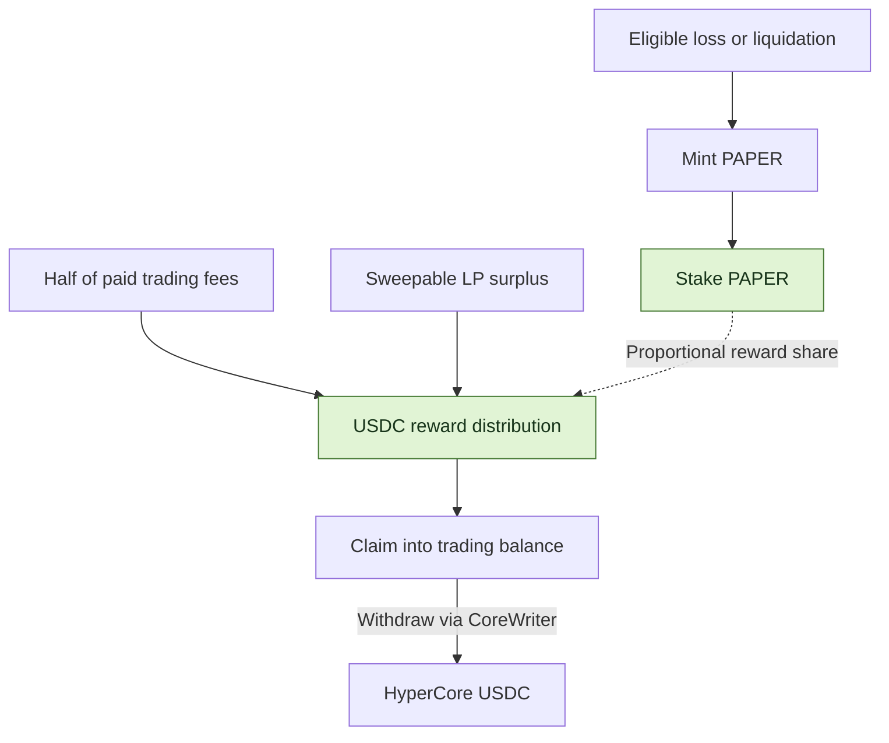

<h1 align="center">papertrade-research</h1>

<p align="center">
  <strong>Settlement costs, LP exposure and PAPER distributions in Papertrade.</strong>
</p>


<p align="center">
  <a href="docs/mechanism-map.md"></a>
  <a href="STATUS.md"></a>
  <a href="LICENSE"></a>
</p>

<p align="center">
  <a href="README.zh-CN.md">中文</a> ｜ <strong>English</strong>
</p>

<p align="center">
  <a href="#features">Features</a> ·
  <a href="#paper-mint-curve">Mint curve</a> ·
  <a href="#trading-costs">Fees</a> ·
  <a href="#paper-the-dividend-token">PAPER</a> ·
  <a href="#explore-the-research">Explore the research</a> ·
  <a href="docs/sources.md">Sources</a>
</p>

[Papertrade](https://docs.papertrade.xyz/) is a perpetuals protocol on HyperEVM with a documented maximum leverage of 1000×.
Traders settle against the protocol LP. Eligible realized losses generate PAPER, and staked PAPER shares participate in USDC distributions.

🔎 This repository examines traders' net cash flows, LP exposure, and the funding and constraints behind PAPER distributions.
Inputs include user observations, documentation, frontend and bytecode analysis, public transaction records and offline calculations. See [sources](docs/sources.md) and [research status](STATUS.md) for their basis and verification status.

## Features

| Mechanism | Rule | Effect on cash flows or execution |
|---|---|---|
| **Protocol LP as counterparty** | Every trade settles directly with the Papertrade protocol liquidity pool. | The LP takes the other side of trader PnL; gain payments also depend on available backing and the payout queue. |
| 📊 **Pricing and settlement** | Contracts read the HyperCore best-bid/ask midpoint; positions and balances are recorded on HyperEVM. | Reference prices and net PnL require separate calculation, including gain adjustments and fees. |
| **Leverage and isolated margin** | Documented leverage is up to 1000×; margin and leverage are fixed at open, and positions close in full. | Leverage magnifies price moves relative to margin. Long and short positions do not cross-collateralize. |
| **Fee structure** | Opening fees and funding payments are zero; the relayer pays gas for relayed trades. | Profitable closes still incur deadband, nonlinear gain adjustment and a 2% fee on adjusted profit. |
| ⏳ **Execution queue** | The relayer receives, queues and batches market intents on chain. | Opens and closes can wait during busy periods. Prices can move, and liquidation can precede a queued close. |
| **Losses and PAPER issuance** | Eligible loss basis determines PAPER issuance along the emission curve. | Token amounts and claimable USDC are different quantities; USDC distributions also depend on funding and staked share. |

The current product is web-based, with no standalone mobile app. It supports market orders, without limit orders or automatic take-profit/stop-loss.
Settlement uses the execution-time BBO midpoint without order-book-depth matching. Price moves during waiting and gain adjustments still affect the outcome.

> 🖥️ <strong>Operational constraint:</strong> Active position management requires manual monitoring and close submission, adding a time and attention cost. A submitted close still awaits execution.

[Trading mechanics](docs/mechanism-map.md)

## PAPER mint curve


The figure uses documented example parameters. Below <strong>$2M tracked LP</strong>, the flat region mints <strong>100 PAPER per $1 of eligible loss basis</strong>.
At or above the threshold, the marginal rate is `r(H) = R × [S / (S + H)]²`, with documented examples `R = 100`, `S = $120M`, and cumulative tail progress `H`.

<strong>Current LP and H are different variables.</strong> Distributions reduce LP without resetting H. The right panel fixes retained `H = $260.5M`, giving about <strong>9.9 PAPER/$</strong>,
to illustrate the threshold step rather than a live point. Whole-trade issuance integrates over its interval; it is not simply loss times the displayed marginal rate.

⚙️ <strong>Parameter authority:</strong> the contract owner can change the LP threshold, flat mint rate, decay scale and LP reward cap, affecting subsequent emissions or distributions.
[Mint formula and figure inputs](docs/readme-figures.md#mint-rate-illustration) · [Parameter authority](docs/readme-figures.md#parameter-authority)

## Trading costs

| When | What the trader pays |
|---|---|
| **Open a position** | 0 opening fee |
| **Keep a position open** | 0 funding payments |
| **Execute a relayed trade** | Gas is paid by the relayer |
| **Close at a profit** | Deduct deadband, adjust the gain, then charge **2% of adjusted profit** |
| **Close at a loss** | The realized loss, with no extra trading fee |

The deadband is approximately <strong>0.002%</strong> of entry price. In the documented examples, the nonlinear adjustment removes about <strong>10% to nearly 100%</strong> of the post-deadband gain; smaller favorable price moves lose more.
The final 2% applies to adjusted profit, not position notional.

[Gain formula and BTC/ETH examples](docs/readme-figures.md#profit-retention-examples)

## Who pays whom?



| Two separate waits | What is waiting? |
|---|---|
| **Execution queue** | An open or close intent waiting for relayer selection and successful execution. |
| **Payout queue** | A settled claim waiting for available LP backing and harvest; the documented payout order is FIFO. |

With cash-funded positions, returned margin is credited separately from unpaid gains.
Debt-funded losses cancel the corresponding claim rather than bring in new cash.
[Execution queue and payout mechanics](docs/research-notes/007-queue-and-dividend-payment.md)

## PAPER: the dividend token

PAPER issuance uses eligible loss basis. USDC distributions are funded by paid trading fees and sweepable LP surplus. The two require separate accounting.



| Item | Rule and conditions |
|---|---|
| **Issuance basis** | Emissions follow eligible loss basis and curve progress. Issuing PAPER does not itself return the USDC loss. |
| 📥 **Distribution share** | Rewards accrue by staked share; holding alone does not participate. The documented mechanism has no staking lockup or cooldown. |
| **Funding sources** | Half of paid trading fees, plus sweepable tracked-LP excess above its configured cap; the documented example cap is $5M. |
| ↗️ **Payment path** | Claiming credits the trading balance; withdrawal to HyperCore is a separate step. Internal accounting and external receipt are distinct. |

[Mint curve & staking analysis](docs/research-notes/006-current-mechanisms.md) · [Dividend payment path](docs/research-notes/007-queue-and-dividend-payment.md)

## Liquidation: trigger price and margin loss

The documented liquidation buffer is approximately 5 basis points (0.05%), applied to the theoretical zero-equity reference toward entry.
Liquidation consumes the position's full isolated margin; the price buffer is not returned to the trader.

> <strong>Illustrative 100× long:</strong> entry 100 → theoretical zero-equity price 99 →
> liquidation trigger about **99.05**. A voluntary close just before the trigger
> can still return equity; liquidation at the trigger consumes the whole margin.


The buffer applies to the zero-equity reference price. At entry 100, 100× leverage and a 0.05% buffer, the continuous long-side result is **99.0495 ≈ 99.05**; the contract rounds in integer price units.
Higher leverage makes the same small price buffer a larger fraction of margin.
[Exact formula & rounding](docs/research-notes/006-current-mechanisms.md#liquidation-exact-buffer-basis-and-inclusive-threshold)

## Explore the research

| Start here | What you will find |
|---|---|
| [Mechanism map](docs/mechanism-map.md) | A guide to the protocol's 14 research areas |
| [Research notes](docs/research-notes/) · [Case records](research/cases/) | Explanations, source coordinates and structured outcomes |
| [Offline arithmetic](packages/research/mechanics.ts) | Mint-curve, bust-price and pending-reward helpers |
| [Evidence tooling](docs/chain-evidence.md) | Record validation and version consistency |
| [Collection](docs/readonly-collection.md) · [Safe export](docs/safe-export.md) | Bounded public reads and reviewed metadata export |
| [Method](docs/research-method.md) · [Progress](STATUS.md) · [Roadmap](ROADMAP.md) | Research process, verification status and next milestones |

<details>
<summary><strong>Run the local checks</strong> · Node.js ≥ 24.12.0 / pnpm 11.25.0</summary>

```sh
pnpm install --frozen-lockfile
pnpm test
pnpm typecheck
pnpm validate:records
```

Tests and validation run locally. Live collection is an explicit, separate command.

</details>

---

[Contribute](CONTRIBUTING.md) · [Data policy](DATA_POLICY.md) · [Apache-2.0](LICENSE) · [Third-party notices](THIRD_PARTY_NOTICES.md)
