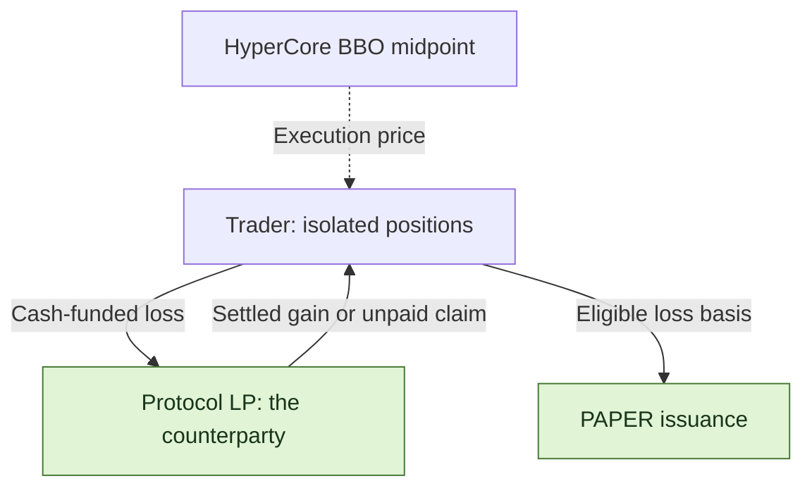
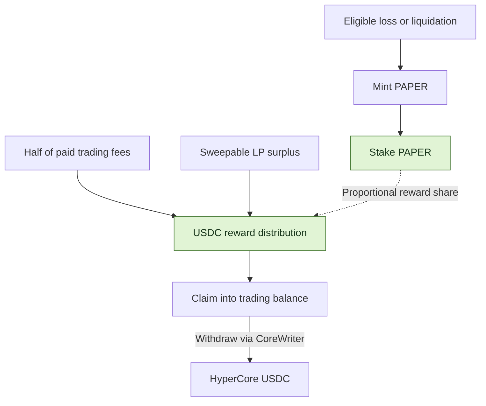

<h1 align="center">papertrade-research</h1>

<p align="center">
  <strong>REA-assisted reverse engineering of Papertrade trading, liquidation and PAPER dividends.</strong>
</p>


<p align="center">
  <a href="docs/mechanism-map.md"></a>
  <a href="STATUS.md"></a>
  <a href="LICENSE"></a>
</p>

<p align="center">
  <a href="README.zh-CN.md">中文</a> ｜ <strong>English</strong>
</p>

<p align="center">
  <a href="#features">Features</a> ·
  <a href="#paper-mint-curve">Mint curve</a> ·
  <a href="#trading-costs">Fees</a> ·
  <a href="#paper-the-dividend-token">PAPER</a> ·
  <a href="#independent-clients-and-api-access">API access</a> ·
  <a href="#explore-the-research">Explore the research</a> ·
  <a href="docs/sources.md">Sources</a>
</p>

[Papertrade](https://docs.papertrade.xyz/) is a perpetuals protocol on HyperEVM: trades settle against the protocol LP, losses can generate PAPER, and staked PAPER participates in USDC distributions.

🔎 This repository uses [REA](https://github.com/morluto/rea) and manual analysis to examine its fees, liquidation rules and the link between losses and PAPER incentives. [Research status](STATUS.md) · [Sources](docs/sources.md)

## Features

| Feature | How it works |
|---|---|
| 🤝 **Protocol LP as counterparty** | Every trade settles directly with the Papertrade protocol liquidity pool, which takes the other side of trader PnL. |
| 📊 **Hyperliquid pricing** | Contracts read the HyperCore best-bid/ask midpoint; accounting and settlement run on HyperEVM. |
| ⚡ **Up to 1000×, isolated margin** | Margin and leverage are fixed at open. Each position closes in full; long and short positions are independent. |
| 💸 **0 opening fee · 0 funding payments** | Profitable closes incur gain adjustment and fees. The relayer pays gas for relayed trades. |
| ⏳ **Queues during busy periods** | The relayer receives, queues and batches market intents on chain. Both opens and closes can wait. |
| 🪙 **Losses generate PAPER** | Eligible losses and liquidations mint PAPER along the emission curve; staked PAPER shares participate in USDC distributions. |

> 🖥️ <strong>Manual monitoring required:</strong> The current product has web-based market orders, without limit orders, automatic take-profit/stop-loss or a standalone mobile app.
> At high leverage, a small adverse move can liquidate a position. Controlling exit timing requires watching prices and closing manually; liquidation can still precede a queued close.

🧩 <strong>The mechanism to examine:</strong> A losing close or liquidation generates PAPER from eligible loss basis; staking PAPER then participates in distributions. Liquidation risk and post-loss token incentives sit inside the same system.

[Trading mechanics](docs/mechanism-map.md)

## PAPER mint curve

**Issuance changed from a decaying token-per-dollar curve to a fraction of existing supply.** Eligible losses grow the total supply; read the token count together with the share it represents.


| What matters | Old mechanism | New mechanism |
|---|---|---|
| **PAPER per $1 of loss** | 100 PAPER/$ was the early/low-LP flat branch; the old tail already decayed with cumulative progress H, for example 25 → 20 → about 10. Re-entering above the threshold at retained H can step down; 25/20 are not fixed tiers. | Roughly 0.1% of then-current supply per $1M eligible loss. Larger supply means more tokens for the same loss; the configured coefficient determines the exact rate. |
| **How issuance grows** | In the tail, equal losses produce progressively fewer new tokens. | Eligible losses keep issuing a proportion of supply; there is no fixed daily release in this mechanism. Unchanged holdings represent a smaller supply share. |
| **During insolvency** | The old flat branch applies. | A continuous-insolvency time multiplier rises from 1× to 5× over three days, limited to the eligible deficit-repair portion. |

💡 **Token count and total supply belong together:** starting from 10 billion PAPER, the figure's simplified 0.1% issuance per $1M eligible-loss step gives **10bn → 10.01bn → 10.02001bn**. This is an illustration, not exact contract settlement or an equal increase in USDC backing.

📍 **2026-10-22 acquisition snapshot:** approximately **8.903 billion PAPER** in total supply and a **9.802 PAPER/$** base marginal rate. The quantities are related; neither is live. Actual distributions also depend on funding, staking shares and allocation timing.

🗓️ **Change timeline:** the retained old docs page is dated **2026-10-06** and still showed the old curve when acquired October 21; the announcement displays **2026-10-20, 6:30 AM** (timezone unknown); **installation and new-mode enablement were checked October 22**. The exact upgrade execution time remains unreconstructed.

[Old official description](https://docs.papertrade.xyz/how/mint-curve/) · [Official new-rule announcement](https://x.com/papertrade_xyz/status/2112310325521399982) · [Figure, issuance examples and formula appendix](docs/readme-figures.md#issuance-old-vs-new) · [Contract evidence and version record](docs/research-notes/014-official-announcement-crosscheck.md#2-supply-relative-issuance-and-insolvency-timing)

## Trading costs

| When | What the trader pays |
|---|---|
| **Open a position** | 0 opening fee |
| **Keep a position open** | 0 funding payments |
| **Execute a relayed trade** | Gas is paid by the relayer |
| **Close at a profit** | Deduct deadband, adjust the gain, then charge **2% of adjusted profit** |
| **Close at a loss** | The realized loss, with no extra trading fee |

💡 The deadband is approximately <strong>0.002%</strong> of entry price. An additional nonlinear adjustment affects favorable underlying-price moves within <strong>6bps (0.06%) during on-hours</strong> or <strong>10bps (0.1%) during off-hours</strong>; its effect is zero at the band endpoints and outside its configured band. These are price-move thresholds, not fee rates. Existing deadband, asymmetric impact and the final 2% of adjusted profit still matter outside the new band.

[Adjustment and boundary checks](docs/research-notes/014-official-announcement-crosscheck.md#3-the-new-profit-adjustment-is-a-price-move-band) · [Earlier baseline formula](docs/readme-figures.md#profit-retention-examples)

**Fees and settlement rules can change.** Owner changes and upgrades follow governance authority. The observed timelock minimum delay is one day; the guardian can pause new opens without scheduling, while resumption requires owner authority. [Rule authority](docs/research-notes/011-loss-governance-staking-and-payments.md#2-who-can-change-rules-and-what-actually-changed) · [Upgrade records](docs/research-notes/013-market-state-funding-and-upgrade-followup.md#1-the-scheduled-implementations-are-now-installed)

## Who pays whom?



| Two separate waits | What is waiting? |
|---|---|
| **Execution queue** | An open or close intent waiting for relayer selection and successful execution. |
| **Payout queue** | A settled claim waiting for available LP backing and harvest; the documented payout order is FIFO. |

With cash-funded positions, returned margin is credited separately from unpaid gains.
Debt-funded losses cancel the corresponding claim rather than bring in new cash.
PAPER issuance and tracked LP are therefore not substitutes for cash available to pay winners. A payout queue orders available funding; it does not create funds or establish a fixed clearance time. Actual active-debt and partial-payment cases remain missing.
[Execution queue and payout mechanics](docs/research-notes/007-queue-and-dividend-payment.md) · [Payment capacity and conditional examples](docs/research-notes/011-loss-governance-staking-and-payments.md#5-payment-capacity-when-many-traders-win)

## PAPER: the dividend token

🪙 Eligible loss basis drives PAPER issuance; trading fees and LP surplus fund USDC distributions.

**PAPER is not freely transferable between wallets.** The configured staking route controls transfers. The team links this policy to the risk that an external PAPER short could increase the payoff from attacking LP solvency. This is a conditional economic argument, not proof that external derivatives or manipulation are impossible. [Transfer restrictions and risk argument](docs/research-notes/014-official-announcement-crosscheck.md#1-transfer-restrictions-and-the-external-short-argument)



| Step | Rule |
|---|---|
| 🪙 **Minting** | Eligible basis, current supply and insolvency timing determine the amount. |
| 📥 **Staking** | Distributions accrue by share at allocation; holding alone does not participate. New stake can share earlier undistributed funds. No documented lockup or cooldown. |
| 💵 **Funding** | Half of paid trading fees, plus sweepable tracked-LP excess above the cap; the documented example cap is $5M. |
| ↗️ **Claiming** | Claim into trading balance, then withdraw separately to HyperCore. |

**Allocation timing determines who shares each distribution.** In the acquired code, holding time adds no extra weight, and stake and unstake do not first distribute accumulated fees. With 100 reward units waiting, two equal stakes share 50 each if the second joins before allocation; if allocation happens first, the original stake receives 100. Already allocated rewards remain with their holder, including after unstaking. This is a conditional code example, not a demonstrated real timing strategy. [Staking timing](docs/research-notes/011-loss-governance-staking-and-payments.md#3-long-term-staking-versus-joining-immediately-before-allocation)

Eight checked distributions across two separate windows match fee funding; none establishes an additional LP-surplus transfer. That does not rule out surplus funding elsewhere. A proposal setting the LP reward cap to $10M was cancelled, not applied. Allocation, claim credit and external payment remain separate checks. [Funding records and reserve ledger](docs/research-notes/011-loss-governance-staking-and-payments.md#4-where-distributions-actually-came-from) · [Cap cancellation](docs/research-notes/011-loss-governance-staking-and-payments.md#2-who-can-change-rules-and-what-actually-changed)

[Mint curve & staking analysis](docs/research-notes/006-current-mechanisms.md) · [Dividend payment path](docs/research-notes/007-queue-and-dividend-payment.md)

## Liquidation: trigger price and margin loss

⚠️ Liquidation triggers before the theoretical zero-equity price. The documented buffer is about 5 basis points (0.05%), applied to that reference. Liquidation consumes the full isolated margin.


> 🧮 <strong>Illustrative 100× long:</strong> entry 100 → zero-equity price 99 → liquidation price about 99.0495 ≈ 99.05.
> A voluntary close before the trigger can return remaining equity; liquidation consumes the full margin.

Higher leverage makes the buffer a larger fraction of margin. See [formula and rounding](docs/research-notes/006-current-mechanisms.md#liquidation-exact-buffer-basis-and-inclusive-threshold).

## Independent clients and API access

🛠️ The integration route is **read rules and account state → sign an intent →
submit to the official relayer → reconcile execution and balances**. A custom
client can use these interfaces to build its own trading workflow; opens and
closes still pass through the authorized BatchExecutor.

| Interface | Role in a custom client |
|---|---|
| HTTP queries: `/query/protocol/…` | Protocol summaries, queue information and PAPER activity for monitoring the protocol. |
| Public WebSocket: `trading:current` | Trading availability and market rules, including leverage and position limits, for validating an order. |
| Account queries and SSE: `/query/accounts/…`, `/state/user/live?wallet=…` | Balance, positions, operation status and history for reconciling the user's account. Account-access requirements still need to be established. |
| Signed commands: `POST /intents` | Session registration, opens/closes, withdrawal to HyperCore and PAPER actions. Match the receipt to the intent, then follow execution; acceptance alone is not a fill. |

Selected position IDs can be closed in full; another open creates a separate
position. A supported interface for reducing part of one position, native
limit/TP/SL orders or changing existing margin/leverage has not been established.

**Deposits and withdrawals:**

| Deposit source | Funding route |
|---|---|
| Ethereum, Arbitrum or Solana USDC | Circle-related burn and forwarding to the user's deposit proxy, followed by platform processing and trading-balance credit. |
| Robinhood USDG | Across bridges into USDC on HyperEVM, then the destination handler forwards it through CoreDepositWallet to the proxy. |
| HyperEVM or HyperCore USDC | Internal Core/EVM transfers into the proxy, followed by platform credit. |

Withdrawals first move platform balance to the user's HyperCore spot account.
Routes onward to HyperEVM, Ethereum, Arbitrum or Solana require additional
transfer authorization; the recovered withdrawal routes do not include Robinhood.
Bridge completion, platform credit and arrival at the final destination are
separate stages.

**Still missing for a complete integration:** server admission and account access,
reliable reconnect/reconciliation behavior, full fee/arrival/refund handling, and
builder attribution and fee rules. Across also marks the captured
`/suggested-fees` interface as legacy, so a new integration needs its migration path.

**Builder codes:** the team announced an initial whitelist. Recovered registry and enablement gates support controlled admission; fee base, payout and live registration policy still need verification. [Builder boundaries](docs/research-notes/014-official-announcement-crosscheck.md#4-builders-distribution-permissions-and-below-bust-closes)

[API and signing guide](docs/independent-client-guide.md) ·
[Order capabilities and funding routes](docs/research-notes/012-independent-clients-orders-and-bridges.md)

## Explore the research

| Start here | What you will find |
|---|---|
| [Mechanism map](docs/mechanism-map.md) | A guide to the protocol's 14 research areas |
| [Research notes](docs/research-notes/) · [Case records](research/cases/) | Explanations, source coordinates and structured outcomes |
| [Losses, governance and staking timing](docs/research-notes/011-loss-governance-staking-and-payments.md) | Five questions with real records, code observations, conditional examples and remaining gaps |
| [REA analysis](docs/research-notes/010-rea-frontend-and-contract-crosscheck.md) | Client submission paths, PAPER ratio display and contract interface inferences |
| [Offline arithmetic](packages/research/mechanics.ts) | Mint-curve, bust-price and pending-reward helpers |
| [Evidence tooling](docs/chain-evidence.md) | Record validation and version consistency |
| [Collection](docs/readonly-collection.md) · [Safe export](docs/safe-export.md) | Bounded public reads and reviewed metadata export |
| [Method](docs/research-method.md) · [Progress](STATUS.md) · [Roadmap](ROADMAP.md) | Research process, verification status and next milestones |

<details>
<summary><strong>Run the local checks</strong> · Node.js ≥ 24.12.0 / pnpm 11.25.0</summary>

```sh
pnpm install --frozen-lockfile
pnpm test
pnpm typecheck
pnpm validate:records
```

Tests and validation run locally. Live collection is an explicit, separate command.

</details>

---

[Contribute](CONTRIBUTING.md) · [Data policy](DATA_POLICY.md) · [Apache-2.0](LICENSE) · [Third-party notices](THIRD_PARTY_NOTICES.md)
