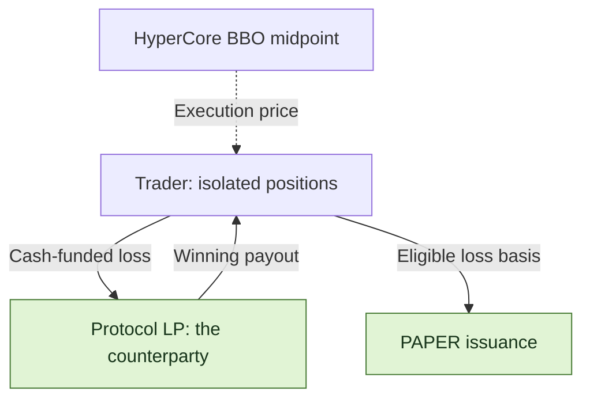
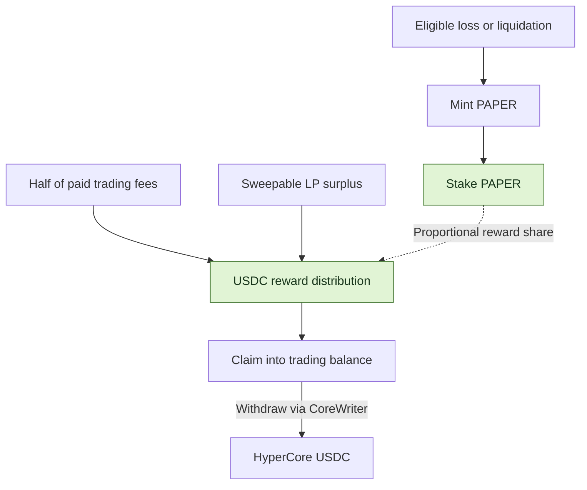

<h1 align="center">Papertrade Mechanics Lab</h1>

<p align="center">
  <strong>Inside 1000× perpetuals, loss-to-PAPER emissions, and staking dividends.</strong>
</p>


<p align="center">
  <a href="https://docs.papertrade.xyz/"></a>
  <a href="STATUS.md"></a>
  <a href="LICENSE"></a>
</p>

<p align="center">
  <a href="README.zh-CN.md">简体中文</a> ·
  <a href="#mechanisms-at-a-glance">Mechanisms</a> ·
  <a href="#trading-costs">Fees</a> ·
  <a href="#paper-the-dividend-token">PAPER</a> ·
  <a href="#explore-the-lab">Explore the lab</a> ·
  <a href="docs/sources.md">Sources</a>
</p>

[Papertrade](https://docs.papertrade.xyz/) is a HyperEVM perpetuals protocol with up to
**1000× leverage**. Traders settle against its liquidity pool; realized losses mint
**PAPER**, which can be staked for dividends from paid trading fees and LP surplus.

This independent lab explains those mechanics through frontend and bytecode analysis,
public transaction cases, and reproducible research tools.

## Mechanisms at a glance

| Feature | How Papertrade works |
|---|---|
| **The LP is your counterparty** | Every trade settles against the protocol's liquidity pool. Papertrade does not match you with another trader. |
| **Hyperliquid prices, HyperEVM settlement** | Contracts read the HyperCore best-bid/ask midpoint. Positions and balances live on HyperEVM. |
| **Up to 1000×, isolated per position** | Margin and leverage are fixed at open; each position closes in full. Separate long and short positions can coexist. |
| **No opening fee or funding payments** | The trader's protocol charges come from profitable closes. The relayer pays gas for relayed trades. |
| **Opens and closes can wait** | Signed market intents pass through the relayer's execution queue before on-chain processing. A queued close can still be liquidated first. |
| **Losses earn PAPER** | Eligible realized losses and liquidations mint PAPER along a decaying emission curve. Staking PAPER earns a share of USDC distributions. |

The current official app uses market execution, without limit, take-profit or stop-loss orders.
[Official trading guide →](https://docs.papertrade.xyz/learn/trades-pricing/)

## Trading costs

| When | What the trader pays |
|---|---|
| **Open a position** | **0 opening fee** |
| **Keep a position open** | **0 funding payments** |
| **Execute a relayed trade** | Gas is paid by the relayer |
| **Close at a profit** | A deadband and nonlinear gain adjustment, then **2% of the adjusted profit** |
| **Close at a loss** | The realized loss; no additional fee on top of it |

**Winning close:** market gain → deadband / gain adjustment → 2% win fee → net gain.
The 2% is charged on adjusted profit, not position notional: an adjusted gain of
100 USDC incurs a 2 USDC win fee. Loss-close and liquidation fee shares can be
carved from the LP's proceeds rather than added to the trader's loss.
[Fee mechanics →](https://docs.papertrade.xyz/learn/wins-losses/)

## Who pays whom?



| Two separate waits | What is waiting? |
|---|---|
| **Execution queue** | An open or close intent waiting for relayer selection and successful execution. |
| **Payout queue** | A settled claim waiting for available LP backing and harvest; the documented payout order is FIFO. |

With cash-funded positions, returned margin is credited separately from unpaid gains.
Debt-funded losses cancel the corresponding claim rather than bring in new cash.
[Execution queue](docs/research-notes/007-queue-and-dividend-payment.md) · [Payout mechanics](https://docs.papertrade.xyz/how/solvency-queue/)

## PAPER: the dividend token

**Losses mint it. Staking activates the reward share. Distributions pay in USDC.**



| PAPER feature | What it means |
|---|---|
| **Earned through losses** | Emissions follow eligible loss basis and curve progress; PAPER per dollar is not fixed. |
| **Stake to participate** | Holding alone does not earn dividends. Rewards accrue by staked share, with no documented lockup or cooldown. |
| **Two reward sources** | Half of paid trading fees, plus sweepable tracked-LP excess above its configured cap, documented at **$5M**. |
| **Claim, then withdraw** | Claiming credits the trading balance. Moving USDC to HyperCore is a separate withdrawal. |

[Official dividends](https://docs.papertrade.xyz/learn/staking-dividends/) · [Mint curve & staking analysis](docs/research-notes/006-current-mechanisms.md)

## Liquidation: the buffer matters

Liquidation triggers **before the theoretical zero-equity price**. The documented
buffer is about **5 basis points (0.05% of price)** toward entry. This is a price
buffer, not a promise to return the remaining margin: triggering liquidation
consumes the position's **full isolated margin**.

> **Illustrative 100× long:** entry 100 → theoretical zero-equity price 99 →
> liquidation trigger about **99.05**. A voluntary close just before the trigger
> can still return equity; liquidation at the trigger consumes the whole margin.

Higher leverage makes the same small price buffer a larger fraction of margin.
[Liquidation guide](https://docs.papertrade.xyz/learn/liquidations/) · [Exact formula & rounding](docs/research-notes/006-current-mechanisms.md#liquidation-exact-buffer-basis-and-inclusive-threshold)

## Explore the lab

| Start here | What you will find |
|---|---|
| [Mechanism map](docs/mechanism-map.md) | A guide to the protocol's 14 research areas |
| [Research notes](docs/research-notes/) · [Case records](research/cases/) | Explanations, source coordinates and structured outcomes |
| [Offline arithmetic](packages/research/mechanics.ts) | Mint-curve, bust-price and pending-reward helpers |
| [Evidence tooling](docs/chain-evidence.md) | Record validation and version consistency |
| [Collection](docs/readonly-collection.md) · [Safe export](docs/safe-export.md) | Bounded public reads and reviewed metadata export |
| [Method](docs/research-method.md) · [Progress](STATUS.md) · [Roadmap](ROADMAP.md) | Research process, verification status and next milestones |

<details>
<summary><strong>Run the local checks</strong> · Node.js ≥ 24.12.0 / pnpm 11.25.0</summary>

```sh
pnpm install --frozen-lockfile
pnpm test
pnpm typecheck
pnpm validate:records
```

Tests and validation run locally. Live collection is an explicit, separate command.

</details>

---

[Contribute](CONTRIBUTING.md) · [Data policy](DATA_POLICY.md) · [Apache-2.0](LICENSE) · [Third-party notices](THIRD_PARTY_NOTICES.md)
