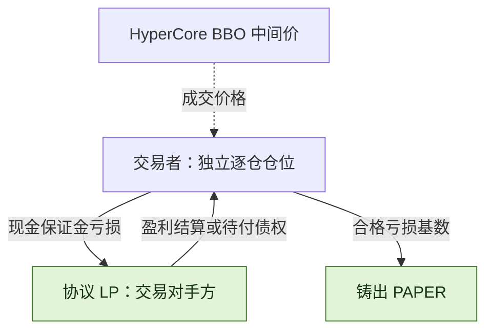
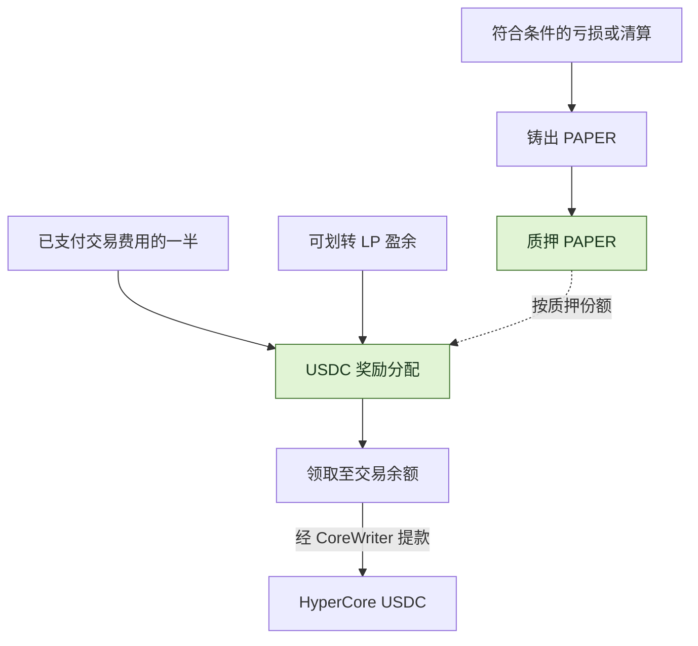

<h1 align="center">papertrade-research</h1>

<p align="center">
  <strong>Papertrade 的结算成本、LP 风险与 PAPER 分配机制研究。</strong>
</p>


<p align="center">
  <a href="docs/mechanism-map.md"></a>
  <a href="STATUS.md"></a>
  <a href="LICENSE"></a>
</p>

<p align="center">
  <strong>中文</strong> ｜ <a href="README.md">English</a>
</p>

<p align="center">
  <a href="#特性介绍">特性介绍</a> ·
  <a href="#paper-铸币曲线">铸币曲线</a> ·
  <a href="#交易成本">交易费用</a> ·
  <a href="#paper分红代币怎样运作">PAPER 分红</a> ·
  <a href="#探索研究仓库">仓库导航</a> ·
  <a href="docs/sources.md">来源</a>
</p>

[Papertrade](https://docs.papertrade.xyz/) 是 HyperEVM 上的永续合约协议，文档列出的最高杠杆为 1000×。
交易者与协议 LP 结算，符合条件的已实现亏损产生 PAPER；PAPER 质押份额参与 USDC 分配。

🔎 本仓库分析交易者的净收支、LP 承担的风险，以及 PAPER 分配的资金来源与约束。
分析依据包括用户观察、文档、前端与字节码、公开交易记录和离线计算；各项依据及验证进度见[来源](docs/sources.md)和[研究状态](STATUS.md)。

## 特性介绍

| 机制 | 规则 | 对收支或执行的影响 |
|---|---|---|
| **协议 LP 作为对手方** | 每笔交易直接与 Papertrade 协议流动性池结算。 | 交易者的盈亏由 LP 承接；盈利的支付还取决于可用背书资金和赔付队列。 |
| 📊 **价格与结算** | 合约读取 HyperCore 最优买卖价的中间价，仓位和余额记在 HyperEVM。 | 参考价格与最终净盈亏需要分别计算，后者还受盈利调整和费用影响。 |
| **杠杆与逐仓隔离** | 文档最高杠杆为 1000×；保证金与杠杆开仓时固定，每仓整仓平仓。 | 杠杆放大价格变动对保证金的影响；多空仓位独立，不互相补充保证金。 |
| **费用结构** | 开仓手续费与资金费率为 0；relayer 支付其代发交易的 gas。 | 盈利平仓仍有 deadband、非线性盈利调整及调整后盈利的 2% 手续费。 |
| ⏳ **执行排队** | 市价交易意图由 relayer 接收、排队并批量上链。 | 高峰期的开／平仓可能等待；参考价格会变化，排队中的平仓可能先被清算。 |
| **亏损与 PAPER 发行** | 合格亏损基数按排放曲线对应 PAPER 数量。 | 代币数量与可领取的 USDC 是不同的量；USDC 分配还取决于资金来源和质押份额。 |

当前产品通过网页使用，暂无独立手机 App；只有市价单，没有限价单或自动止盈／止损。
按执行时的 BBO 中间价结算，不经过订单簿深度撮合；等待期间的价格变动与盈利调整仍会影响结果。

> 🖥️ <strong>操作约束：</strong> 主动管理仓位需要自己看盘并手动提交平仓，构成人工值守和时间成本。提交平仓后仍需等待执行。

[交易机制导览](docs/mechanism-map.md)

## PAPER 铸币曲线


图中使用文档示例参数。Tracked LP 低于 <strong>200 万美元</strong>时，平坦段为每 1 美元合格亏损基数铸 <strong>100 PAPER</strong>；
达到阈值后，边际铸币率遵循 `r(H) = R × [S / (S + H)]²`。文档示例为 `R = 100`、`S = 1.2 亿美元`，`H` 是累计尾段进度。

<strong>当前 LP 与 H 是两个量。</strong> 分红划走 LP 不会重置 H。右图固定保留 `H = 2.605 亿美元`，尾段约为 <strong>9.9 PAPER/$</strong>，
用于说明阈值处的阶跃，不是实时点位。一次亏损的实际铸币量需要沿区间计算，不是简单用图上的边际值乘亏损。

⚙️ <strong>参数权限：</strong>合约 owner 可修改 LP 阈值、平坦铸币率、衰减尺度与 LP 分红上限；这些值会影响后续排放或分配。
[铸币公式与绘图输入](docs/readme-figures.md#mint-rate-illustration) · [参数调整权限](docs/readme-figures.md#parameter-authority)

## 交易成本

| 发生什么 | 交易者承担什么成本 |
|---|---|
| **开仓** | 0 开仓手续费 |
| **持仓** | 0 资金费率 |
| **Relayer 执行交易** | Gas 由 relayer 支付 |
| **盈利平仓** | 先扣 deadband、调整盈利，再收取 <strong>调整后盈利的 2%</strong> |
| **亏损平仓** | 承担亏损，不额外加收交易费 |

Deadband 约为开仓价的 <strong>0.002%</strong>。文档示例中，非线性调整会削减 deadband 后盈利的约 <strong>10% 到接近 100%</strong>；顺向价格变动越小，削减越明显。
最后的 2% 按调整后盈利计算，不按仓位名义本金计算。

[盈利调整公式与 BTC／ETH 示例](docs/readme-figures.md#profit-retention-examples)

## 盈亏由谁承担？



| 两种不同的等待 | 等待的是什么？ |
|---|---|
| **执行排队** | 开／平仓意图等待 relayer 选取并成功执行。 |
| **赔付排队** | 已结算债权等待可用 LP 背书资金与 harvest；文档描述的赔付顺序为 FIFO。 |

现金开仓的保证金返还与未付盈利分开记账；债权保证金的亏损销毁相应债权，不形成新增现金。
[执行队列与赔付机制](docs/research-notes/007-queue-and-dividend-payment.md)

## PAPER：分红代币怎样运作？

PAPER 发行以合格亏损基数为输入，USDC 分配以已支付交易费用及可划转 LP 盈余为资金来源。两者需要分别核算。



| 项目 | 规则与条件 |
|---|---|
| **发行基数** | 铸币量取决于合格亏损基数和曲线进度；PAPER 发行本身不返还 USDC 亏损。 |
| 📥 **分配份额** | 奖励按质押份额累计；仅持有不参与分配。文档描述的质押机制无锁定期或冷却期。 |
| **资金来源** | 已支付交易费用的一半，以及 tracked LP 超过设定上限后可划转的盈余；文档示例上限为 500 万美元。 |
| ↗️ **支付路径** | 领取先计入交易余额，再单独提款至 HyperCore；内部记账与外部到账是两个步骤。 |

[铸币与质押机制分析](docs/research-notes/006-current-mechanisms.md) · [分红支付路径](docs/research-notes/007-queue-and-dividend-payment.md)

## 清算：触发价格与保证金损失

文档描述的清算缓冲约为 5 个基点（0.05%），基于理论归零价计算，向开仓价方向提前触发。
触发清算后，损失的是该仓位的全部逐仓保证金；这个价格缓冲不会返还给交易者。

> <strong>100× 多仓示意：</strong> 开仓价 100 → 理论归零价 99 → 清算触发价约 **99.05**。
> 在触发前主动平仓仍可能返还部分权益；触发清算则损失整笔保证金。


缓冲作用于理论归零价。开仓价 100、100× 杠杆、缓冲比例 0.05% 时，多仓连续计算结果为 **99.0495 ≈ 99.05**；合约按整数价格单位逐步取整。
杠杆越高，同样的小幅价格缓冲，占保证金的比例越大。
[精确公式与取整](docs/research-notes/006-current-mechanisms.md#liquidation-exact-buffer-basis-and-inclusive-threshold)

## 探索研究仓库

| 从这里开始 | 可以找到什么 |
|---|---|
| [机制地图](docs/mechanism-map.md) | 协议的 14 个研究方向 |
| [研究笔记](docs/research-notes/) · [案例记录](research/cases/) | 机制解释、来源坐标与结构化结果 |
| [离线算术](packages/research/mechanics.ts) | 铸币曲线、清算价格和待领取奖励的计算函数 |
| [证据工具](docs/chain-evidence.md) | 记录验证与版本一致性检查 |
| [只读采集](docs/readonly-collection.md) · [安全导出](docs/safe-export.md) | 有界公开读取与经审阅的元数据导出 |
| [研究方法](docs/research-method.md) · [研究进度](STATUS.md) · [路线图](ROADMAP.md) | 工作方法、验证状态与下一阶段目标 |

<details>
<summary><strong>运行本地检查</strong> · Node.js ≥ 24.12.0 / pnpm 11.25.0</summary>

```sh
pnpm install --frozen-lockfile
pnpm test
pnpm typecheck
pnpm validate:records
```

测试与验证在本地运行；在线采集使用单独的显式命令。

</details>

---

[参与贡献](CONTRIBUTING.md) · [数据政策](DATA_POLICY.md) · [Apache-2.0](LICENSE) · [第三方声明](THIRD_PARTY_NOTICES.md)
