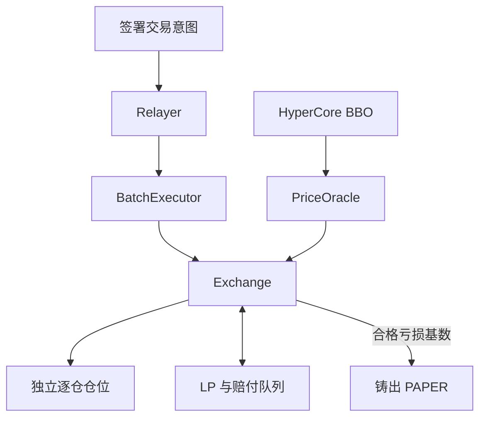
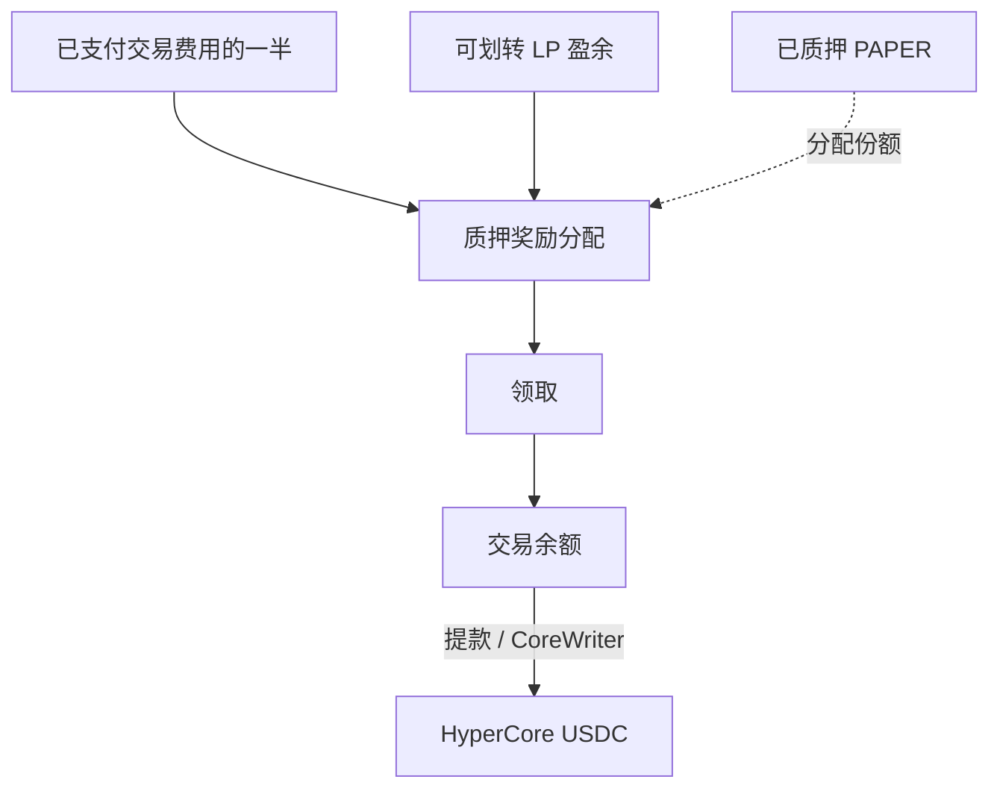

<h1 align="center">Papertrade Mechanics Lab</h1>

<p align="center">
  <strong>读懂 1000× 永续合约、亏损铸 PAPER 与质押分红。</strong>
</p>


<p align="center">
  <a href="https://docs.papertrade.xyz/"></a>
  <a href="STATUS.md"></a>
  <a href="LICENSE"></a>
</p>

<p align="center">
  <a href="README.md">English</a> ·
  <a href="#机制速览">机制速览</a> ·
  <a href="#沿着证据阅读">研究发现</a> ·
  <a href="#探索研究仓库">仓库导航</a> ·
  <a href="docs/sources.md">来源</a>
</p>

[Papertrade](https://docs.papertrade.xyz/) 是 HyperEVM 上最高支持 **1000× 杠杆**的永续合约协议。
交易者与协议流动性池结算；已实现亏损铸出 **PAPER**，质押后可分享已支付交易费用和 LP 盈余带来的分红。

这个独立研究仓库通过前端与字节码分析、公开交易案例和可复用工具，拆解这些机制。

## 机制速览

| 机制 | 怎样运作 | 深入阅读 |
|---|---|---|
| **交易执行** | 签署的意图先在 relayer 等待，再作为批次中的独立调用执行。 | [排队与批处理](docs/research-notes/007-queue-and-dividend-payment.md) |
| **仓位** | 逐仓保证金、固定杠杆、整仓平仓；同一账户可以分别持有多仓和空仓。 | [多空双开案例](docs/research-notes/006-current-mechanisms.md#case-005-opposite-positions-can-coexist-in-the-observed-case) |
| **结算** | 盈利依次经过 deadband、非线性调整和费用计算；未支付部分进入另一条赔付队列。 | [PnL 与整数算术](docs/research-notes/004-economic-path-and-state-audit.md) |
| **PAPER 与分红** | 符合条件的亏损沿衰减曲线铸币；质押 PAPER 后按份额累计分配的奖励。 | [铸币与质押](docs/research-notes/006-current-mechanisms.md) |
| **清算** | 带缓冲的爆仓阈值触发清算，损失该仓位的全部逐仓保证金。 | [触发条件与取整](docs/research-notes/006-current-mechanisms.md#liquidation-exact-buffer-basis-and-inclusive-threshold) |

当前官方界面采用市价执行，没有限价单、止盈或止损单。

## 从签署意图到交易结算



| 两条不同的队列 | 等待的是什么？ | 由什么推进？ |
|---|---|---|
| **执行队列** | 等待处理的签名操作 | Relayer 选取、提交，以及单项调用成功执行 |
| **赔付队列** | 尚未支付的结算债权 | 可用背书资金与 harvest；官方机制按 FIFO 赔付 |

## 从 PAPER 到质押分红

**质押 PAPER → 累计奖励 → 领取至交易余额 → 提款至 HyperCore。**



仅持有 PAPER 不参与分红。官方列出的奖励来源是已支付交易费用的一半，以及超过设定上限后可划转的 LP 盈余。

## 沿着证据阅读

| 问题 | 抽样案例得到的结果 | 研究记录 |
|---|---|---|
| 整笔批次成功，是否代表每项都成功？ | **734 项结果：730 成功、4 失败**；失败后仍有后续调用成功执行。 | [007 · 批次结果](docs/research-notes/007-queue-and-dividend-payment.md) |
| 饱和度 0% 是否代表没有积压？ | 服务快照出现 **217 条意图排队、饱和度 0%**。 | [008 · 后台排队压力](docs/research-notes/008-core-credit-and-relayer-pressure.md) |
| 同时做多做空，合起来也会亏钱吗？ | 一对已平仓仓位的事件合计交易 PnL 约 **−0.223207** 内部单位；亏损腿另铸约 **3.421797 PAPER**。 | [006 · 双开案例](docs/research-notes/006-current-mechanisms.md#case-005-opposite-positions-can-coexist-in-the-observed-case) |
| 分红 reserve 的变化能否对账？ | **3 次分配与后续 33 次领取**，滚动计算匹配已捕获的官方 API reserve。 | [009 · 最新：奖励储备账本](docs/research-notes/009-distribution-reserve-ledger.md) |
| 选定提款是否到达 HyperCore？ | **1115.251244 USDC** 与官方账本的入账记录匹配。 | [008 · 入账核对](docs/research-notes/008-core-credit-and-relayer-pressure.md#selected-withdrawal-one-exact-official-ledger-match) |

**证据状态：**研究结合官方说明、取得的代码与服务商返回的链上事件。
完整历史重放、后台调度规则及 LP 盈余／债权分支仍待补齐。[验证与进度 →](STATUS.md)

## 探索研究仓库

| 从这里开始 | 可以找到什么 |
|---|---|
| [机制地图](docs/mechanism-map.md) | 协议的 14 个研究方向 |
| [研究笔记](docs/research-notes/) · [案例记录](research/cases/) | 机制解释、来源坐标与结构化结果 |
| [离线算术](packages/research/mechanics.ts) | 铸币曲线、爆仓价格和待领取奖励的计算函数 |
| [证据工具](docs/chain-evidence.md) | 记录验证与版本一致性检查 |
| [只读采集](docs/readonly-collection.md) · [安全导出](docs/safe-export.md) | 有界公开读取与经审阅的元数据导出 |
| [研究方法](docs/research-method.md) · [路线图](ROADMAP.md) | 工作方法与下一阶段目标 |

<details>
<summary><strong>运行本地检查</strong> · Node.js ≥ 24.12.0 / pnpm 11.25.0</summary>

```sh
pnpm install --frozen-lockfile
pnpm test
pnpm typecheck
pnpm validate:records
```

测试与验证在本地运行；在线采集使用单独的显式命令。

</details>

---

[参与贡献](CONTRIBUTING.md) · [数据政策](DATA_POLICY.md) · [Apache-2.0](LICENSE) · [第三方声明](THIRD_PARTY_NOTICES.md)
