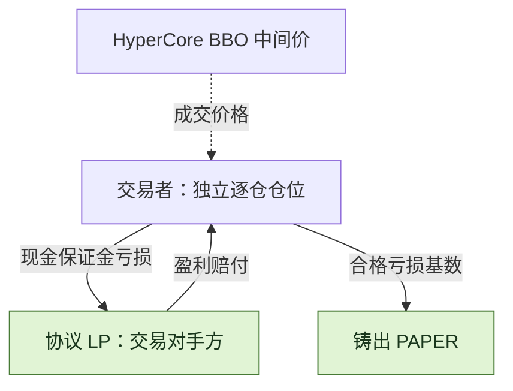
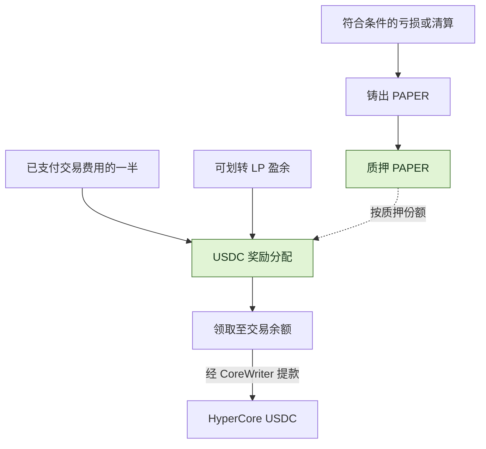

<h1 align="center">Papertrade Mechanics Lab</h1>

<p align="center">
  <strong>读懂 1000× 永续合约、亏损铸 PAPER 与质押分红。</strong>
</p>


<p align="center">
  <a href="https://docs.papertrade.xyz/"></a>
  <a href="STATUS.md"></a>
  <a href="LICENSE"></a>
</p>

<p align="center">
  <a href="README.md">English</a> ·
  <a href="#机制速览">机制速览</a> ·
  <a href="#交易成本">交易费用</a> ·
  <a href="#paper分红代币怎样运作">PAPER 分红</a> ·
  <a href="#探索研究仓库">仓库导航</a> ·
  <a href="docs/sources.md">来源</a>
</p>

[Papertrade](https://docs.papertrade.xyz/) 是 HyperEVM 上最高支持 **1000× 杠杆**的永续合约协议。
交易者与协议流动性池结算；已实现亏损铸出 **PAPER**，质押后可分享已支付交易费用和 LP 盈余带来的分红。

这个独立研究仓库通过前端与字节码分析、公开交易案例和可复用工具，拆解这些机制。

## 机制速览

| 特性 | Papertrade 怎样运作 |
|---|---|
| **对手方是协议 LP** | 每笔交易都与协议流动性池结算，不是撮合另一位交易者与你对赌。 |
| **Hyperliquid 定价，HyperEVM 结算** | 合约读取 HyperCore 最优买卖价的中间价；仓位和余额记在 HyperEVM。 |
| **最高 1000×，逐仓隔离** | 保证金和杠杆开仓时固定，每个仓位整仓平仓；可以分别持有多仓和空仓。 |
| **无开仓费、无资金费率** | 交易者的额外协议成本发生在盈利平仓；经 relayer 执行的交易由其支付 gas。 |
| **开仓、平仓都可能排队** | 签署的市价意图先经 relayer 排队，再上链执行；排队中的平仓仍可能先被清算。 |
| **亏损铸 PAPER，质押分 USDC** | 符合条件的已实现亏损和清算沿衰减曲线铸币；质押 PAPER 后按份额参与分红。 |

当前官方界面采用市价执行，没有限价单、止盈或止损单。
[官方交易说明 →](https://docs.papertrade.xyz/learn/trades-pricing/)

## 交易成本

| 发生什么 | 交易者承担什么成本 |
|---|---|
| **开仓** | **0 开仓手续费** |
| **持仓** | **0 资金费率** |
| **Relayer 执行交易** | Gas 由 relayer 支付 |
| **盈利平仓** | 先扣除 deadband 并做非线性盈利调整，再收取**调整后盈利的 2%** |
| **亏损平仓** | 承担已实现亏损，不在亏损以外再加收一笔费用 |

**盈利路径：**市场盈利 → deadband／盈利调整 → 2% 盈利手续费 → 净盈利。
2% 按调整后的盈利计算，不按仓位名义本金计算：调整后盈利 100 USDC，盈利手续费为 2 USDC。
亏损平仓与清算时，协议可能从 LP 所得中分出费用，不会在交易者既有亏损之外再扣一次。
[费用机制 →](https://docs.papertrade.xyz/learn/wins-losses/)

## 盈亏由谁承担？



| 两种不同的等待 | 等待的是什么？ |
|---|---|
| **执行排队** | 开／平仓意图等待 relayer 选取并成功执行。 |
| **赔付排队** | 已结算债权等待可用 LP 背书资金与 harvest；官方赔付顺序为 FIFO。 |

现金开仓的保证金返还与未付盈利分开记账；债权保证金的亏损销毁相应债权，不形成新增现金。
[执行队列](docs/research-notes/007-queue-and-dividend-payment.md) · [赔付机制](https://docs.papertrade.xyz/how/solvency-queue/)

## PAPER：分红代币怎样运作？

**亏损时铸币，质押后参与分配，奖励以 USDC 支付。**



| PAPER 特性 | 对使用者意味着什么 |
|---|---|
| **通过亏损获取** | 铸币量取决于合格亏损基数和曲线进度，每亏 1 美元获得的 PAPER 数量并不固定。 |
| **质押才参与分红** | 仅持有不分红；奖励按质押份额累计，官方机制无锁定期或冷却期。 |
| **两条分红来源** | 已支付交易费用的一半，以及 tracked LP 超过设定上限后可划转的盈余；官方列出的上限为 **500 万美元**。 |
| **领取与提款分两步** | 领取先计入交易余额，再通过单独的提款操作把 USDC 转到 HyperCore。 |

[官方分红说明](https://docs.papertrade.xyz/learn/staking-dividends/) · [铸币与质押机制分析](docs/research-notes/006-current-mechanisms.md)

## 清算：为什么缓冲很重要？

清算会在**理论归零价之前**触发。官方描述的缓冲约为**价格的 5 个基点（0.05%）**，朝开仓价方向提前。
这是价格缓冲，不是保证金返还保护：一旦触发清算，损失的是该仓位的**全部逐仓保证金**。

> **100× 多仓示意：**开仓价 100 → 理论归零价 99 → 清算触发价约 **99.05**。
> 在触发前主动平仓仍可能返还部分权益；触发清算则损失整笔保证金。

杠杆越高，同样的小幅价格缓冲，占保证金的比例越大。
[官方清算说明](https://docs.papertrade.xyz/learn/liquidations/) · [精确公式与取整](docs/research-notes/006-current-mechanisms.md#liquidation-exact-buffer-basis-and-inclusive-threshold)

## 探索研究仓库

| 从这里开始 | 可以找到什么 |
|---|---|
| [机制地图](docs/mechanism-map.md) | 协议的 14 个研究方向 |
| [研究笔记](docs/research-notes/) · [案例记录](research/cases/) | 机制解释、来源坐标与结构化结果 |
| [离线算术](packages/research/mechanics.ts) | 铸币曲线、爆仓价格和待领取奖励的计算函数 |
| [证据工具](docs/chain-evidence.md) | 记录验证与版本一致性检查 |
| [只读采集](docs/readonly-collection.md) · [安全导出](docs/safe-export.md) | 有界公开读取与经审阅的元数据导出 |
| [研究方法](docs/research-method.md) · [研究进度](STATUS.md) · [路线图](ROADMAP.md) | 工作方法、验证状态与下一阶段目标 |

<details>
<summary><strong>运行本地检查</strong> · Node.js ≥ 24.12.0 / pnpm 11.25.0</summary>

```sh
pnpm install --frozen-lockfile
pnpm test
pnpm typecheck
pnpm validate:records
```

测试与验证在本地运行；在线采集使用单独的显式命令。

</details>

---

[参与贡献](CONTRIBUTING.md) · [数据政策](DATA_POLICY.md) · [Apache-2.0](LICENSE) · [第三方声明](THIRD_PARTY_NOTICES.md)
