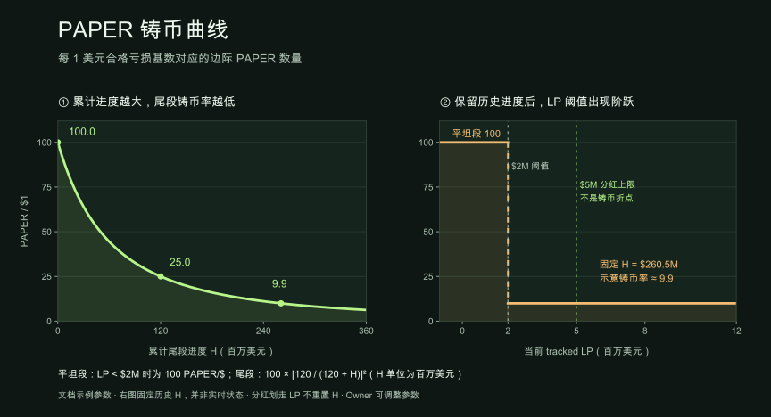
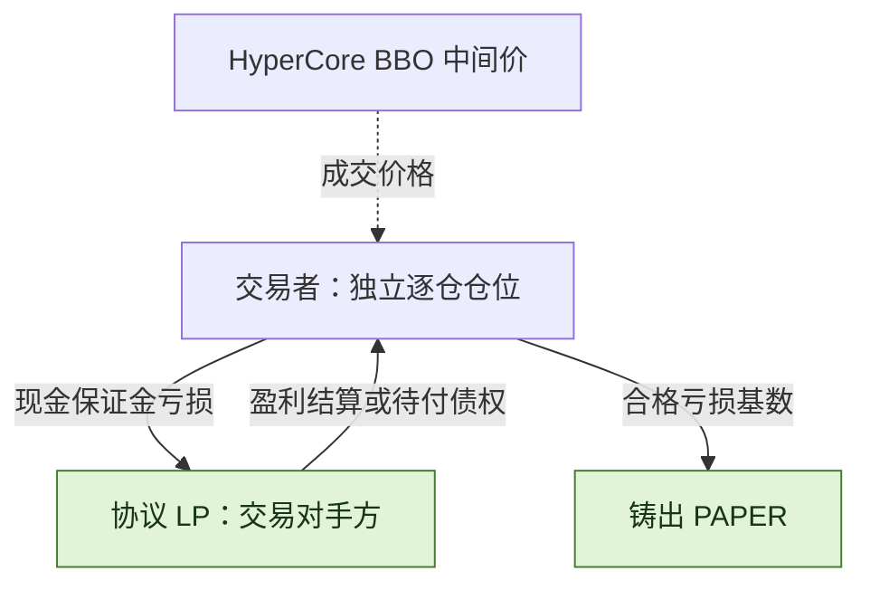
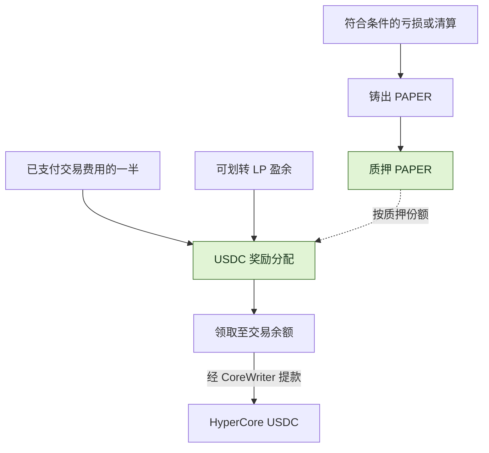
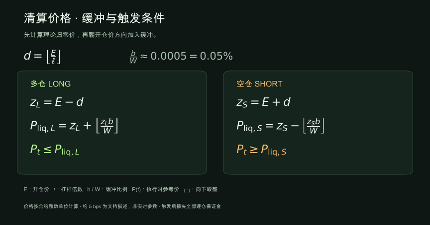

<h1 align="center">papertrade-research</h1>

<p align="center">
  <strong>Papertrade 机制研究：交易、清算与 PAPER 分红。</strong>
</p>


<p align="center">
  <a href="docs/mechanism-map.md"></a>
  <a href="STATUS.md"></a>
  <a href="LICENSE"></a>
</p>

<p align="center">
  <strong>中文</strong> ｜ <a href="README.md">English</a>
</p>

<p align="center">
  <a href="#特性介绍">特性介绍</a> ·
  <a href="#paper-铸币曲线">铸币曲线</a> ·
  <a href="#交易成本">交易费用</a> ·
  <a href="#paper分红代币怎样运作">PAPER 分红</a> ·
  <a href="#探索研究仓库">仓库导航</a> ·
  <a href="docs/sources.md">来源</a>
</p>

[Papertrade](https://docs.papertrade.xyz/) 是 HyperEVM 上的永续合约协议：与协议 LP 交易，亏损可产生 PAPER，质押参与 USDC 分红。

🔎 这个仓库研究它怎样收费、怎样清算，以及亏损和 PAPER 激励怎样连在一起。[研究进度](STATUS.md) · [来源](docs/sources.md)

## 特性介绍

| 特性 | 怎么运作 |
|---|---|
| 🤝 **与协议 LP 交易** | 每笔交易直接与 Papertrade 协议流动性池结算，盈亏由 LP 承接。 |
| 📊 **Hyperliquid 定价** | 读取 HyperCore 最优买卖价的中间价，在 HyperEVM 记账结算。 |
| ⚡ **最高 1000×，逐仓隔离** | 保证金与杠杆开仓时固定，每仓整仓平仓；多空仓位独立。 |
| 💸 **0 开仓费 · 0 资金费率** | 盈利平仓有盈利调整和手续费；经 relayer 执行的交易由其支付 gas。 |
| ⏳ **高峰期可能排队** | 市价意图由 relayer 接收、排队并批量上链；开仓和平仓都可能等待。 |
| 🪙 **亏损产生 PAPER** | 合格亏损和清算按排放曲线铸币；质押 PAPER 后按份额参与 USDC 分配。 |

> 🖥️ <strong>需要自己盯盘：</strong> 目前只有网页市价单，没有限价单、自动止盈止损或独立手机 App。
> 高杠杆下，小幅逆向波动就可能爆仓。想控制退出时机，需要自己看盘、手动平仓；平仓排队时也仍可能被清算。

🧩 <strong>机制看点：</strong> 亏损平仓／清算结束仓位，同时按合格亏损基数产生 PAPER；PAPER 质押后再参与分红。清算风险与亏损后的代币激励，被放在了同一套机制里。

[交易机制导览](docs/mechanism-map.md)

## PAPER 铸币曲线



- 📉 <strong>怎么衰减：</strong> 文档示例中，LP 低于 200 万美元时为 100 PAPER/$；达到阈值后，铸币率随累计尾段进度 H 衰减。
- ⚙️ <strong>谁能调整：</strong> 合约 owner 可修改 LP 阈值、铸币率、衰减尺度和 LP 分红上限。

H 是累计进度，分红减少 LP 不会重置 H。右图固定 H 展示阈值阶跃，使用示例参数；整笔铸币按区间计算。
[公式与绘图输入](docs/readme-figures.md#mint-rate-illustration) · [参数权限](docs/readme-figures.md#parameter-authority)

🔎 已采集的前端代码中，**PAPER 比例函数**按铸币数量 ÷ 合格亏损基数计算该笔平均比例。[REA 与前端复核](docs/research-notes/010-rea-frontend-and-contract-crosscheck.md#captured-paper-ratio-formatter)

## 交易成本

| 发生什么 | 交易者承担什么成本 |
|---|---|
| **开仓** | 0 开仓手续费 |
| **持仓** | 0 资金费率 |
| **Relayer 执行交易** | Gas 由 relayer 支付 |
| **盈利平仓** | 先扣 deadband、调整盈利，再收取 <strong>调整后盈利的 2%</strong> |
| **亏损平仓** | 承担亏损，不额外加收交易费 |

💡 Deadband 约为开仓价的 <strong>0.002%</strong>。文档示例中，非线性调整会削减 deadband 后盈利的约 <strong>10% 到接近 100%</strong>；顺向价格变动越小，削减越明显。
最后的 2% 按调整后盈利计算，不按仓位名义本金计算。

[盈利调整公式与 BTC／ETH 示例](docs/readme-figures.md#profit-retention-examples)

## 盈亏由谁承担？



| 两种不同的等待 | 等待的是什么？ |
|---|---|
| **执行排队** | 开／平仓意图等待 relayer 选取并成功执行。 |
| **赔付排队** | 已结算债权等待可用 LP 背书资金与 harvest；文档描述的赔付顺序为 FIFO。 |

现金开仓的保证金返还与未付盈利分开记账；债权保证金的亏损销毁相应债权，不形成新增现金。
[执行队列与赔付机制](docs/research-notes/007-queue-and-dividend-payment.md)

## PAPER：分红代币怎样运作？

🪙 PAPER 把合格亏损转成代币发行；USDC 分红的资金来自交易费用和 LP 盈余。



| 环节 | 规则 |
|---|---|
| 🪙 **铸币** | 合格亏损基数与曲线进度决定数量。 |
| 📥 **质押** | 按质押份额累计分红，仅持有不分红；文档无锁定期或冷却期。 |
| 💵 **资金来源** | 已支付交易费用的一半，加上 tracked LP 超过上限的可划转盈余；文档示例上限为 500 万美元。 |
| ↗️ **领取** | 先计入交易余额，再单独提款至 HyperCore。 |

[铸币与质押机制分析](docs/research-notes/006-current-mechanisms.md) · [分红支付路径](docs/research-notes/007-queue-and-dividend-payment.md)

## 清算：触发价格与保证金损失

⚠️ 清算在理论归零价之前触发。文档缓冲约为 5 个基点（0.05%），按归零价计算；一旦触发，损失整笔逐仓保证金。



> 🧮 <strong>100× 多仓示意：</strong> 开仓价 100 → 理论归零价 99 → 清算价约 99.0495 ≈ 99.05。
> 触发前主动平仓可返还剩余权益；触发清算则损失整笔保证金。

杠杆越高，缓冲占保证金的比例越大。具体取整见[公式与计算](docs/research-notes/006-current-mechanisms.md#liquidation-exact-buffer-basis-and-inclusive-threshold)。

## 探索研究仓库

| 从这里开始 | 可以找到什么 |
|---|---|
| [机制地图](docs/mechanism-map.md) | 协议的 14 个研究方向 |
| [研究笔记](docs/research-notes/) · [案例记录](research/cases/) | 机制解释、来源坐标与结构化结果 |
| [REA 分析](docs/research-notes/010-rea-frontend-and-contract-crosscheck.md) | 客户端提交路径、PAPER 比例显示与合约接口推断 |
| [离线算术](packages/research/mechanics.ts) | 铸币曲线、清算价格和待领取奖励的计算函数 |
| [证据工具](docs/chain-evidence.md) | 记录验证与版本一致性检查 |
| [只读采集](docs/readonly-collection.md) · [安全导出](docs/safe-export.md) | 有界公开读取与经审阅的元数据导出 |
| [研究方法](docs/research-method.md) · [研究进度](STATUS.md) · [路线图](ROADMAP.md) | 工作方法、验证状态与下一阶段目标 |

<details>
<summary><strong>运行本地检查</strong> · Node.js ≥ 24.12.0 / pnpm 11.25.0</summary>

```sh
pnpm install --frozen-lockfile
pnpm test
pnpm typecheck
pnpm validate:records
```

测试与验证在本地运行；在线采集使用单独的显式命令。

</details>

---

[参与贡献](CONTRIBUTING.md) · [数据政策](DATA_POLICY.md) · [Apache-2.0](LICENSE) · [第三方声明](THIRD_PARTY_NOTICES.md)
