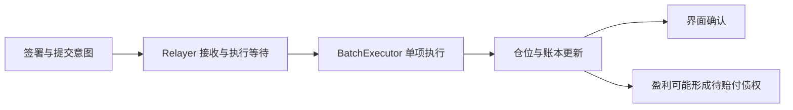

# Papertrade Mechanics Lab

**研究 Papertrade 的交易、结算与 PAPER 机制。**

这是一个独立开源研究项目。我们阅读官方资料、分析前端与合约字节码，并核对公开交易事件，
解释交易怎样执行、亏损怎样铸币、收益怎样分配，以及余额和待赔付债权怎样变化。

[English](README.md) · [机制地图](docs/mechanism-map.md) · [最新机制研究](docs/research-notes/006-current-mechanisms.md) · [来源](docs/sources.md)

以下结论注明**官方说明、字节码支持、链上案例支持、独立复验通过**的区别。
本轮有部分字节码和链上案例支持，完整历史结算尚未通过独立复验。参数和规则需要按版本核对。

## 开仓和平仓为什么会等待？

**已确认前端存在交易意图排队状态和排队编号；后端的调度顺序、优先级和实际等待时长尚未证实。**
官方架构要求开、平仓经 relayer 和 BatchExecutor 执行。前端收到接收确认后显示 `queued`，
确认不明确时保留 `unconfirmed`，并在有排队意图时每两秒查询排队位置。
这两秒是界面轮询间隔，不是成交期限。批处理交易成功，还需核对其中单条调用的结果。



**执行等待和赔付等待是两件事。** 官方赔付机制将未付债权按 FIFO 排队，通过可用资金和后续 harvest 支付。
现金保证金平仓时，返还保证金与未付盈利分别记账；债权保证金原本就是待赔付债权，平仓后整个剩余债权可能再次排队。
开仓不因赔付队列存在而一概停止，但仍受余额、方向容量和债权处理限制。
本轮未取得用户提交、接收、广播到成交的完整时间线，也未复验活跃赔付队列的完整账本。

**证据：官方说明＋前端源码；批处理链上事件支持存在逐项成功／失败。**
[详细排队研究](docs/research-notes/006-current-mechanisms.md#case-002-execution-waiting-is-observable-separately-from-payout-waiting) ·
[官方架构](https://docs.papertrade.xyz/how/architecture/) · [官方赔付队列](https://docs.papertrade.xyz/how/solvency-queue/)

## 仓位怎样运作？能否多空双开？

Papertrade 是与协议 LP 对手交易的合成杠杆仓位，引用 Hyperliquid 价格。
文档描述每笔独立逐仓：开仓后保证金和杠杆固定，不能给原仓加仓、追加保证金或部分平仓；
增加敞口需要另开一笔仓位，每笔整仓关闭。文档列出 BTC、ETH 和最高 1000× 杠杆，实际限制需核对部署参数。

**本轮链上案例支持同账户、同市场多空仓位同时存在。** 首组选出的样本有两个独立仓位 ID，
方向相反、开仓价格和保证金相同，第二笔开仓前未见第一笔平仓／清算事件；交易输入与事件字段相符。
这支持双开，不能推出所有账户、方向容量或 relayer 状态下都能接收新单。
两个方向各自占用保证金和方向容量，互不提供跨仓保证金保护。

**双开后的经济结果仍逐腿计算。** 盈利腿经历 deadband、收益调整和费用，亏损腿承担实际亏损，PAPER 另行计算。
该真实样本两腿最终事件所示交易净盈亏合计约 **−0.223207** 个内部记账单位，亏损腿另铸出约 **3.421797 PAPER**。
这不是完整账户余额变化，也未将 PAPER 的市场价值折算进盈亏。双开中的单边清算与债权保证金组合仍待核实。

**证据：字节码支持＋链上案例支持；完整历史结算尚未独立复验。**
[双开案例与金额](docs/research-notes/006-current-mechanisms.md#case-005-opposite-positions-can-coexist-in-the-observed-case) ·
[官方仓位规则](https://docs.papertrade.xyz/learn/trades-pricing/)

## 盈利为什么减少？

盈利路径包含 deadband、非线性收益调整，以及对调整后收益收取的费用。
文档中的启动参数 `10%` 不代表每笔盈利都固定减少 `10%`，描述的 `2%` 费用也有独立计费基数。
本项目已恢复一条盈利分支的逐步整数计算，并与 CASE-001 第 4 条候选金额吻合；
其历史参数和实际价格输入仍缺证据，因此该结果属于同案一致性检查。

**证据：官方说明＋局部字节码支持。** [盈利计算研究](docs/research-notes/004-economic-path-and-state-audit.md)

## 亏损或爆仓后，PAPER 怎样铸造？

**主动亏损平仓与强制清算的铸币基数可能不同，不能简单用“亏了多少 × 当前显示发行率”。**

| 分支 | 官方描述的 PAPER 基数及资金去向 |
|---|---|
| 现金保证金亏损平仓、赔付队列为空 | 如收取 LP 侧亏损费用，铸币基数为亏损减该费用；费用不是额外加到交易者亏损上。 |
| 现金保证金亏损平仓、队列非空 | 不收该费用，按完整亏损铸币；资金进入 sideBucket，优先支持排队赔付。 |
| 现金保证金清算 | 按全部损失保证金铸币；LP 增量可能扣除费用，所以两者金额可以不同。 |
| 债权保证金亏损／清算 | 基数来自被销毁的债权；亏损平仓需考虑适用费用，债权清算无清算费。 |

本轮一笔亏损平仓的“亏损减费用”与 mint 基数吻合；一笔清算以 **20** 为完整保证金基数，
LP 记账只增加 **19.6**，其余 **0.4** 为费用。两笔的 PAPER 铸币 Transfer 都与 tokenomics 事件金额相符。
债权和队列活跃分支目前主要依据官方说明，尚未完成真实案例复验。

发行曲线先平坦、再衰减。本轮文档与参数响应显示：平坦阈值为 **200 万**，平坦率为每单位合格亏损 **100 PAPER**，
尾段衰减尺度为 **1.2 亿**。尾段边际率可写为 `100 × (S / (S + H))²`，
其中 `H` 是累计尾段进度。实际 mint 要跨整个亏损区间积分并逐步取整，不能直接乘一个边际率。
LP 向质押者划出超额收益时，`H` 不随之回退；再次进入尾段会沿用保留的进度。
这些采集时参数不作为任何旧交易的历史输入。

**证据：官方说明＋字节码支持＋两笔铸币事件金额一致；独立历史铸币预期值仍缺失。**
[分支、精确整数公式与案例](docs/research-notes/006-current-mechanisms.md#case-003-loss-basis-liquidation-basis-and-the-mint-curve) ·
[官方发行曲线](https://docs.papertrade.xyz/how/mint-curve/)

## PAPER 分红从哪里来，怎样拿到？

**官方规则要求质押 PAPER 才参与分配，单纯持有不等于已参与分红。** 文档列出两条来源：
已支付交易费用的一半，以及 tracked LP 超过当前描述的 **500 万**上限后的可划拨超额收益。
费用支付仍受赔付队列和偿付条件约束，名义费用不等于当场分红。

收益要经过这些阶段：

`Exchange 累积费用／可划拨盈余 → 推送 → 签名分配 → 按质押份额累计 → 用户 claim → 交易余额`

取得的质押字节码使用 `10^27` 精度累计器；用户待领奖励由已存奖励、质押量、累计器和 reward debt 共同计算。
零质押时，新收到的收益先保持未分配；解除质押不会抹掉已经累计的奖励。
文档说没有锁仓和冷却，但 app 的质押、解押和 claim 仍经签名与 relayer 提交，也会有执行等待。
本轮 stake 与 PAPER 转入相符，claim 与 Exchange 余额入账事件相符；claim 后向外部账户提款是另一个步骤。
首轮窗口没有分配事件，随后另行登记的单块定向样本核对了约 **131.938049** 的费用推送与分配金额一致。
分配前的精确份额、LP 超额收益案例、外部支付和真实解押仍未完成复验。

**证据：官方说明＋字节码支持＋stake／claim 链上案例支持。**
[累计器、分配与领取研究](docs/research-notes/006-current-mechanisms.md#case-004-dividends-are-an-accumulator-and-a-claim-against-internal-balance) ·
[官方质押机制](https://docs.papertrade.xyz/paper/staking/)

## 爆仓价格和清算损失怎样计算？

**取得的字节码显示：触发价包含 buffer，触发后按整笔逐仓保证金硬清算。**
主动平仓仍有剩余权益，并不代表不能触发清算。对已恢复的计算路径，令入场价为 `E`、整数杠杆为 `l`、
buffer 为以 `W = 10^18` 缩放的 `b`：

```text
d = floor(E / l)
多头：z = E - d；清算触发价 = z + floor(z × b / W)
空头：z = E + d；清算触发价 = z - floor(z × b / W)
```

buffer 作用于零权益参考价 `z`，两步取整都要保留。多头价格 **≤** 触发价、空头价格 **≥** 触发价时，
可通过代码中的清算价格检查；等于阈值也包含在内。价格来源还需核对 live BBO／退市冻结价格分支。
合成输入已覆盖阈值两侧和相等情况；这不证明某笔历史交易的实际 bid/ask。

文档描述协议 keeper 监控清算，同时清算维护入口为公开路径。先成功执行的平仓或清算会关闭仓位，
后续重复路径受 open 状态检查约束；用户平仓意图还在等待时，仓位并没有因此获得清算保护。
keeper 的优先级描述不能保证所有真实交易的打包顺序。整仓损失、铸币基数和费用分账仍需一起核对。

**证据：字节码支持＋一笔清算链上案例支持；真实竞态及完整历史结算尚未复验。**
[清算公式、阈值与边界](docs/research-notes/006-current-mechanisms.md#liquidation-exact-buffer-basis-and-inclusive-threshold) ·
[官方清算说明](https://docs.papertrade.xyz/learn/liquidations/)

---

研究采用只读方式，不操作钱包或提交交易。项目非官方；原创代码与文档采用 [Apache-2.0](LICENSE)。
[证据与进度](STATUS.md) · [研究方法](docs/research-method.md) · [贡献与数据边界](CONTRIBUTING.md) · [第三方声明](THIRD_PARTY_NOTICES.md)
