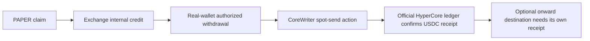

# Confirmed HyperCore credit and observed relayer pressure

Date: 2026-10-21. Baseline: `87c1c91`. This continues [note 007](007-queue-and-dividend-payment.md).
It closes the selected withdrawal's **official-ledger HyperCore credit** gap and
adds actual anonymous relayer telemetry. It does not establish a complete historical
settlement replay or an authenticated server scheduling algorithm.

## Selected withdrawal: one exact official-ledger match

The owner explicitly authorized the previously prepared account/time query before
execution. We used the existing [targeted plan](../../research/cases/004-core-payment-followup-plan.json),
unchanged recipient selection, and the withdrawal block's timestamp ±60 seconds.
The earlier approval-review refusal remains part of the acquisition history; it was
not bypassed. One HTTP request to the official read-only `info` endpoint succeeded,
with no retry, signing, transaction or credential. This raises the previous
follow-up's source count from 22 to **23/30**, within its original budget.

The [confirmation record](../../research/cases/004-core-payment-confirmation.json)
retains response digest/length, acquisition times, match fields and limits. Raw
request, account, ledger hash and response stay private. The response has two
entries; only the unique relevant incoming entry is summarized. Other account
activity is not published or used to extend the authorized lookup.

| Checked field | Result |
|---|---|
| Official response event | `spotTransfer` |
| Asset and amount | **1115.251244 USDC** |
| Eight-decimal amount | `111525124400`, exactly the prior CoreWriter payload |
| Sender | Matches the Exchange protocol account privately |
| Destination | Matches the previously selected withdrawal recipient privately |
| Ledger time | `1792566662344` ms, from the API's entry `time` |
| Authorized interval | `1792566602000–1792566722000` ms |
| Reported transfer fee / native token fee | Both zero for the matched incoming entry |
| Ambiguous matching candidates | None; exactly one entry matches all conditions |

The EVM withdrawal block was **49115156**, hash
`0x0e4392f976424c84e0140981381f62f5604514d096777af0512bf03eeeae340c`.
Its integer-second timestamp is `1792566662`. The ledger's timestamp is in the
same second, but subtraction does **not** yield a measured 344 ms end-to-end
latency: the fields have different sources and resolution, and the actual user
submission/acknowledgement/broadcast times remain unknown.

The supported chain now is:

This is **a provider-reported final HyperCore credit reconciled to the selected
EVM withdrawal**, stronger than a successful EVM receipt alone. It is not an
independent second-provider or consensus replay. It does not prove all withdrawals
succeed, nor that all withdrawn cash came solely from the preceding dividend.
The preceding claim was `1115.251243441981349132` in internal units, slightly less
than the withdrawal; preclaim cash and full distribution provenance remain unknown.
The earlier `131.938049` protocol distribution is still a separate sample. No later
bridge or final external-chain payment is claimed.

## Real backend observation: anonymous relayer pressure

The current official app's `Sy`/`hy` code uses an anonymous **`pressure:current`**
subscription at the stream origin named by the page's metadata. The schema labels
the aggregate snapshot source **`relayer-postgres`** and its chain subsection
`state-postgres`. These are service-reported source labels, not our direct database
access or an independent database audit.

We prospectively registered separate [pressure](../../research/cases/002-public-pressure-stream-plan.json)
and [trading configuration](../../research/cases/002-public-trading-stream-plan.json)
reads. Each used one connection, a protocol `connect`, and one named public
subscription, without account fields, tokens or cookies. No account channel or
`public:trades` feed was subscribed. Limits were ten seconds, bounded frames and
2 MB; no stream retry occurred. The pressure read retained 14 frames, containing
12 full publications; the trading read retained eight frames, including six full
publications, and stopped at its frame limit. Individual command send times were
not separately recorded; source metadata uses the whole connection interval.

Pressure publications report nonzero real execution backlog. Selected snapshots:

| Service timestamp, ms | Queued intents | Submitted intents | Active intents | Submitted gas | Block gas limit | Reported saturation |
|---|---:|---:|---:|---:|---:|---:|
| 1792572653248 | 210 | 0 | 210 | 1,200,000 | 3,000,000 | 40% |
| 1792572654776 | 217 | 0 | 217 | 0 | 3,000,000 | 0% |
| 1792572655775 | 159 | 59 | 218 | 18,375,000 | 3,000,000 | 612.5% |

Across all twelve snapshots, queued intents range **159–217**, and submitted intents
**0–59**. The arithmetic checks pass for every snapshot:

- `activeIntents = queuedIntents + submittedIntents`.
- `totalPendingGas = totalQueuedGas + totalSubmittedGas`.
- Reported `saturationPct` matches `100 × totalSubmittedGas / blockGasLimit`, rounded
  to two decimals, **in this sample**. This is an observed identity, not recovered
  server source or a guarantee for all versions.

Consequently **0% saturation can coexist with 217 queued intents**. This field is
not total backlog divided by a block's gas limit, not the actual percentage of a
mined block used, and not an ETA. `pendingCount` also differs from `activeIntents`
(e.g. 212 versus 210); its definition and relation to intents were not recovered. Positive submitted gas
can coexist with zero `submittedIntents`. We do not silently equate these counters.
The adjacent chain subsection reports actual block usage separately.

This directly supports an operational distinction between **queued** and
**submitted** work. Counts change while backlog persists; it is consistent with
work moving toward submission, but aggregate net counts cannot identify individual
transitions. The feed does not reveal action-specific counts, so these are not
“217 open/close orders.” A submitted intent is not thereby a successful fill.

Queue revision changes are distinct from chain-only updates in the inspected
client. Neither the revision nor the snapshot publication interval proves FIFO,
priority, batch size, retry/backoff, expiry-worker behavior or a guaranteed wait.
No per-intent acceptance times, action breakdown or selected-array ordering were
exposed by this anonymous aggregate stream.

## Current service configuration, separate from scheduler policy

The `trading:current` read reports `indexedThroughBlock` **49121146–49121151**.
Its six publications agree on an empty disabled-action list, `tradingPaused=false`,
minimum margin `10 × 10^18`, minimum open notional `1000 × 10^18`, and minimum PAPER
stake `1000 × 10^18`. The current decoder maps the intake tuple to revision, PAPER
stake minimum and disabled actions. Zero maximum/minimum leverage overrides mean
no additional intake override in this client; they do not mean zero leverage.

These are **actual published service configuration values at observation time**.
We did not submit an intent to test enforcement, and do not substitute them for
historical parameters. Published enabled actions do not prove every order will be
admitted, immediately broadcast or successfully settled. PAPER stake minimum is
not a new open-position margin requirement.

The stream's indexed block heights and pressure chain heights are observations
inside registered wall-clock reads, not a newly chosen historical log window.
No new RPC request or chain log scan was made; all original case windows remain
unchanged. Current app and hooks bytes were refetched and match note 007's retained
bytes. The marketing bundle contains framework mailbox/scheduler terminology;
that client-library code was not mistaken for relayer server scheduling code.

## Primary audit context and remaining server gap

The auditor's own [published report](https://www.guardian.security/portfolio/papertrade/protocol-review-2026-10-09/)
identifies relayer-operated submission and discusses intent validity in KV-14.
KV-19 explicitly places the operated off-chain services outside its contract-review
scope. This provides audit context, not verified scheduling code. The linked source
tree at revision `a467d52a9a` returned 404 through the repository connector. Its
availability and equivalence to the acquired deployment remain unestablished.
Search-result commentary and third-party clients were not used as server-policy proof.

The narrower gap is now clear: **a real nonzero backend queue is observed, but its
selection, priority, retry and expiry algorithm is still unverified**. Decisive
additional evidence would be versioned server implementation/policy or authorized
per-intent receive/ack/select/broadcast/outcome records with clock definitions.
We do not infer these from a queue counter, saturation display or block spacing.
The current official app's lack of limit/TP/SL/scheduled orders remains as described
in note 007; execution backlog is not a user-price conditional order book.

## Acquisition and checks

The scheduler [plan](../../research/cases/002-scheduler-investigation-plan.json)
and [observation record](../../research/cases/002-scheduler-investigation.json) record
**23/30 source accesses**, including 21 successful access units, one connection
failure and one repository 404. The count conservatively charges each public
stream's connection, connect command and subscribe command separately (six units
for two streams). A successful unit is not always an independent HTTP body: stream
units share retained capture digests, and reader/connector captures are distinguished
from upstream body hashes. Source ordinal is recording order; invocation intervals
are retained. One hooks connection failed and one ordinary retry succeeded.
Eight search queries exhausted the registered **8/8** search budget. No new
credential, paid service, deployment or production write was used.

Offline checks verify a unique exact-amount Core ledger match, sender/destination
and range against the prior private receipt, stream channel and schema fields,
all displayed count/gas identities, source digests and original-record immutability.
Publication review excludes raw addresses, ledger hashes, other account activity,
stream client identifiers, signatures and private paths. Verification and independent
review results are recorded in [STATUS](../../STATUS.md). No check here closes M1.
