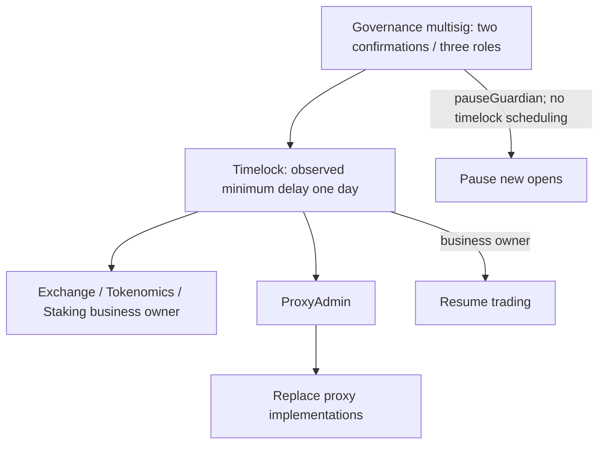

# Loss rewards, governance, staking timing and payment capacity

Research date: 2026-10-21. Baseline: `8e0ba35`. [Metadata record](../../research/cases/008-economics-governance-research.json).
This combines retained evidence with new bounded public reads. **Governance status
is as observed during 13:06–13:14 UTC, not a live publication-time status.**
No complete historical settlement reproduction is claimed.

The practical findings are that PAPER issuance is not equivalent to incoming cash;
the observed governance delay differs from the captured seven-day description;
and staking rewards depend on allocation-time ownership, not elapsed holding time.
Five additional distributions reconcile with fee funding, while real LP-surplus
and active payout-debt examples remain missing.

## 1. Why equal losses can produce different PAPER amounts

**Eligible loss, curve progress and adjustable parameters are separate causes.**
An ordinary cash-funded losing close may deduct an LP-side fee from its mint
basis. Liquidation instead mints on full lost margin. This does not make PAPER
an equal-value cash refund or establish that liquidation is economically preferable.
The [mint documentation](https://docs.papertrade.xyz/how/mint-curve/) and
[queue documentation](https://docs.papertrade.xyz/how/solvency-queue/) describe:

| Settlement branch | Mint basis | Cash and LP distinction |
|---|---|---|
| Cash loss, empty payout queue | Loss minus charged fee | Fee comes from LP's gain; do not deduct it again from trader loss. |
| Cash loss, existing queue | Full loss | Fee waived; cash earmarked in sideBucket; tracked LP increases. |
| Cash liquidation | Full lost margin | Tracked LP increases net of any fee; queue activity waives that fee. |
| Debt-funded losing close | Destroyed claim minus applicable fee | No incoming cash. Fee applies only if queue is empty and free cash covers surviving claim plus fee; otherwise waived. |
| Debt-funded liquidation | Entire destroyed margin claim | No liquidation fee, new cash or sideBucket inflow. |

The acquired arithmetic separates current tracked LP, which selects the flat
region, from retained cumulative tail progress H. Falling LP does not generally
reset H. A loss crossing the threshold must be split and rounded in stages.
The [existing helper](../../packages/research/mechanics.ts) takes all inputs explicitly.

Two retained receipts were checked again; amounts below use 18-decimal internal
accounting units, not independently verified external USDC transfers:

| Receipt | Loss | Fee | Mint basis | Tracked-LP increase | PAPER |
|---|---:|---:|---:|---:|---:|
| [Close, block 49115099](https://hyperevmscan.io/tx/0x24776737d73b9880652a81e4a622f74ae9024c4ba9fd431ccf19394d609a4fd0) | 0.374541263507595663 | 0.007490825270151913 | 0.367050438237443750 | 0.367050438237443750 | 3.657393757128285613 |
| [Liquidation, block 49115441](https://hyperevmscan.io/tx/0xe36d933b3496824ff0c7a66edbe5c4b9b34c4bee37b651cf5770c5b3b4245bf3) | 20 | 0.4 | 20 | 19.6 | 199.285237980903299820 |

These are not equal-loss experiments. Transaction/receipt coordinates, event LP
differences and zero-sender PAPER transfers match. Events report LP before/after
values, but precise prior H, historical parameters and implementation identity
remain missing. Liquidation margin semantics retain the earlier event/code
interpretation rather than an independently obtained historical position state.

Eleven explicit-input calculations isolate the causes. With L=4M, H=120M,
threshold=2M, rate=100 and decay scale=120M, basis 10 yields approximately 250 PAPER;
basis 9.8 yields 245. Changing only H to 260M yields 99.72. Changing only L to 1M
yields 1,000 despite retaining H. At L=1,999,995, basis 10 crosses the threshold and
yields 625, approximately. These are conditional calculations, not historical outputs.
Another vector differs by 722 smallest PAPER units when staged rounding is replaced
with one final division; this tiny difference cannot explain a large visible rate change.

The captured formatter divides `paperMintedRaw` by `paperMintBasisRaw`: an average
over eligible basis, not the current marginal rate. **Its page consumer and runtime
use remain unknown.** REA supports only the captured local formatter-to-guard call.
API fields and a display guard do not authenticate the underlying record.

## 2. Who can change rules, and what actually changed

**The captured official seven-day delay is not the observed configuration.** A
successful governance execution set minimum delay to 86,400 seconds. Business
ownership and proxy administration were checked separately for Exchange,
Tokenomics and Staking. The observed authority chain is:

This identifies contract roles, not people. The multisig execution path requires
a signer other than the proposal submitter. A separate marketKeeper role exists.
Batch's proxy admin matched, but its business-owner query timed out.

| Rule | Observed capability and limitation |
|---|---|
| Win/loss/liquidation fee rates | Owner-guarded setter; each input capped at 0.5 × 10¹⁸ in acquired code. This is a limit, not the actual charged rate. |
| Global trading pause | Guardian can pause; owner can pause or resume. Six synthetic caller/boolean cases support this distinction. |
| Mint threshold, reward cap, rate, decay scale | Owner setter writes four parameters, not H. Reward cap is distinct from the flat-region threshold. |
| Direction limits/minimum opening conditions | Officially assigned to marketKeeper; independent keeper role observed. A separate maximum-leverage setter and its history were not established. |
| Market retirement/frozen close price | Guardian power described by official risk material; full path and a real retirement were not reconstructed. |
| Implementation replacement | Proxy admin routes through owner-controlled ProxyAdmin and timelock in the inspected paths; not a complete bypass/security audit. |
| Minimum delay itself | Timelock self-call setter; no positive lower-bound check found in that acquired path. One day is not an immutable floor. |

Instrument parameters are read during settlement, so relevant changes may affect
existing open positions. Not every setter, bound or historical change was recovered.
No independently authenticated setter for arbitrarily rewriting individual accrued
staking rewards was found; upgrade authority is a broader capability.

| Observed historical action | Result |
|---|---|
| [Delay scheduling, block 48378920](https://hyperevmscan.io/tx/0x24519c5ccf89b6e194379e57ee8fc84a4171b953987d89dac1b969ce3233b2e7) | This operation's ETA minus block time was 604,800 seconds: seven days. |
| [Delay execution, block 49050825](https://hyperevmscan.io/tx/0x0432c2d3013bd958d935a9653cf2cb35253dfb61ca8f56cac4047d708dfd0072) | Successful receipt and event set new minimum delay to 86,400. The event contains only the new value; the complete preceding configuration history was not recovered. |
| [Mint proposal cancellation, block 49079600](https://hyperevmscan.io/tx/0x58809f64eafe8a327db24efeb130b661f85217355dc05f1a6e9ff6cf2d4e3dbe) | Scheduled 10M reward-cap proposal was cancelled, not applied. Observed operation state was zero. |
| [Six-action scheduling, block 49080037](https://hyperevmscan.io/tx/0x0c7e7581647d2a4b1ba70dbdc256d515e5882baf3bd1b6da0f54c264b92c4d95) | Three implementation replacements scheduled; observed operation remained pending. |

The latter ETA is **2026-10-22T05:35:19+08:00**, an earliest executable time, not
automatic execution or a promise. Targets include SessionKeyManager, Exchange and
Tokenomics. New implementations and the other three actions' business semantics
were not analyzed; mechanisms require revalidation if execution occurs. Two direct
mint-parameter attempts also had failed receipts and no logs; failure causes remain
unknown. Captured proxy upgrade paths do not emit standard upgrade/admin events,
so searching only those topics would miss changes.

Sources: [official contract addresses](https://docs.papertrade.xyz/dev/contract-addresses/),
[risk](https://docs.papertrade.xyz/how/risk/), acquired runtime and linked receipts.
The seven-day wording comes from the earlier retained address-page capture, not a
successful fresh fetch. History coverage is limited to acquired address lists,
11 proposal pages (10 successful) and nine execution-entry receipts, not all history.

## 3. Long-term staking versus joining immediately before allocation

**New stake cannot take already allocated rewards, but can share older fees that
have not been allocated yet.** The signed stake, unstake and claim paths settle
existing accumulator entitlement without automatically distributing old fees.
Distribution pushes fees and uses stake present at that execution point.

| Conditional sequence: 100 stake each, 100 unallocated reward | Original staker | New staker |
|---|---:|---:|
| New stake arrives before distribution | 50 | 50 |
| Distribution occurs before new stake | 100 | 0 |
| Original staker exits before distribution | Keeps previously allocated rewards | Receives this 100 if sole remaining stake |
| Distribution with zero stake; later sole stake and redistribution | No retroactive time entitlement | Can receive retained unallocated reward |

Seven offline scenarios entered the acquired staking runtime through signed
dispatchers. Signature recovery, token transfers and Exchange calls were mocked;
initial state was synthetic. Tests checked that only distribution invoked fee push,
and that a claim's credit-call amount/recipient matched its emitted event. This is
not real signature execution, a complete EVM or historical replay. Same-block order
also changes allocation; elapsed days are not an additional weighting factor.

A new [unstake at block 49136723](https://hyperevmscan.io/tx/0x6b9c3dbc795dc68eb3632c511e6e4f41f9680d7a318b92e7646f0a472519f2ec)
matches signed input, PAPER return and Unstaked amount at **762 PAPER**. Its receipt
contains no Distributed event under the checked topic. It proves an observed exit,
not a reconstructed person's earnings or successful allocation-timing strategy.
No recipient identity is published or linked to personal reports.

Sources: [staking terms](https://docs.papertrade.xyz/paper/staking/),
[dividend description](https://docs.papertrade.xyz/learn/staking-dividends/) and
[prior runtime/REA boundaries](010-rea-frontend-and-contract-crosscheck.md).
Public API aggregates cannot recover individual reward debt or keeper ordering.

## 4. Where distributions actually came from

**All five new checked distributions match identified fee funding; none demonstrates
additional LP surplus.** Officially, paid trading fees and eligible LP surplus are
separate sources. Fee accrual, push, allocation, claim to Exchange balance and
external payment are separate stages.

The registered 500-block window is **49136352–49136851**, selected from a captured
summary source height before reading logs. It contains 194 staking and 1,817
Exchange logs. The following equalities hold per checked receipt:

| Block | Fee component = push total = received = allocated |
|---|---:|
| 49136541 | 250.668277406815079555 |
| 49136723 | 126.834746001541392684 |
| 49136754 | 507.292854068373423103 |
| 49136785 | 257.234765131567766603 |
| 49136817 | 186.743521062250653217 |
| Total | **1328.774163670548315162** |

For example, [the last distribution](https://hyperevmscan.io/tx/0x2db865255401e54cb6387ee18702b88a696d20abb377652fcb6aa789ed62b4fc)
has matching push and allocation. Starting from the first event's post-distribution
reserve, adding the later four receipts and subtracting 33 subsequent claims
(272.383548325912139230) yields **3179486.186351889213993283**, matching the final
event/API reserve. Intermediate reserves also reconcile. Five distribution receipts,
coordinates and headers were checked; transaction objects/inputs were not separately
obtained for these five.

The [previous three-distribution window](009-distribution-reserve-ledger.md) also
reconciles on rerun. These disjoint windows must not be joined into continuous cash
flow. Eight fee-supported examples do not establish that surplus never funds rewards.
API source block 49136851 lacks a block hash; provider-internal agreement is not
independent historical-state authentication or an external asset audit.

## 5. Payment capacity when many traders win

**Settlement can create unpaid claims. A queue orders available payments; it does
not create funding or establish a fixed clearance time.** Cash-funded returned
margin is distinct from unpaid profit. Debt-funded collateral is itself a claim,
so its entire surviving amount is subject to payment capacity.

| Item | Why it is not interchangeable with free LP cash |
|---|---|
| Deposits/TVL | New deposits also create user balance obligations. |
| sideBucket | Cash earmarked for existing claims; do not count twice. |
| Tracked LP/PAPER issuance | Debt destruction can increase accounting LP and mint without incoming cash. |
| Staking reserve | Already supports reward obligations, not unrestricted payment capacity. |

The acquired Exchange getter returns zero new-winner budget for three synthetic
nonzero queue inputs. Full FIFO/partial-payment execution remains official
description plus conditional arithmetic, not a replayed queue. For example, claims
70 then 50 with budget 90 imply payments 70 then 20 and remaining debt 30 under
that rule. A conservation check passed; repeated harvest without added funding
cannot remove the remaining cash obligation by itself.

The [summary API](https://exchange.papertrade.xyz/query/protocol/summary) reported
zero queue at block 49136851; [queue-summary](https://exchange.papertrade.xyz/query/protocol/queue-summary)
reported zero amount/count at 49136850. They are adjacent observations from the same
service, not an atomic independent proof or evidence of no historical debt. No
eligible active-debt, partial-payment or queue-head advancement case was established.
The [previous single HyperCore credit](008-core-credit-and-relayer-pressure.md) is
reused without another account lookup; it cannot establish system-wide capacity.

## Collection, checks and remaining limits

A/B used **58 RPC / 16 HTTP / 0 searches**; D/E, including shared unstake evidence,
used **39 RPC / 6 HTTP / 0 searches**. All failures count: B had four transport
failures and one RPC error, plus two HTTP failures; D/E HTTP had one connection
failure. No access-control bypass, signing, transaction, new credentials, paid
service or cloud deployment occurred. A/C otherwise reused local inputs and REA
6.7.0 results; REA was not reinstalled or rerun.

Independent read-only review reran receipt/arithmetic, staking, reserve, getter and
governance-guard checks; source digests and governance operation states agreed.
An initially wrong unstake distribution topic was corrected before final checks.
Public metadata is an explicit projection, not raw evidence or a validated historical
chain packet. Private captures, account joins, signatures and interpreter scripts
remain unpublished. No production code changed or full production suite reran for
this research. Historical implementations, prior curve state, real surplus funding,
active debt and complete contemporaneous asset/liability reconciliation remain open.
