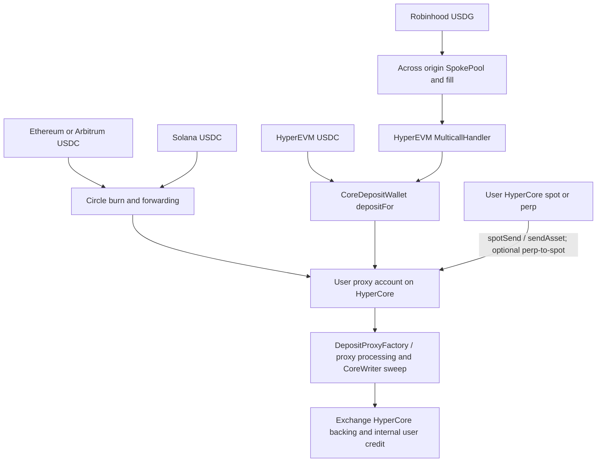
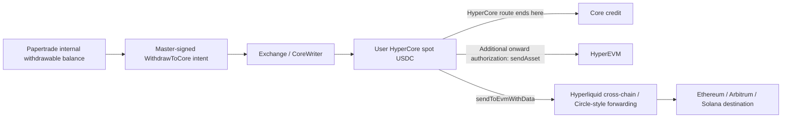

# Independent clients, order capabilities and funding routes

**Later observation (2026-10-22):** the scheduled Exchange, SessionKeyManager and
Tokenomics targets are installed at reference block 49175395. See the
[executed-upgrade follow-up](013-market-state-funding-and-upgrade-followup.md#1-the-scheduled-implementations-are-now-installed).
The implementation identities, pending state and byte ranges below remain dated
observations; they are not silently carried forward to the new implementations.

Date: 2026-10-22, Asia/Singapore. Baseline: `2759cc3`.
[Developer guide](../independent-client-guide.md) ·
[Reviewed source/REA metadata](../../research/cases/009-client-orders-bridges.json).

**An independent frontend has a concrete route through the official intent API.
It does not acquire open/close execution permission by broadcasting its own
transaction.** Current selected code supports whole-position closes and separate
additional positions. No native conditional-order or existing-position margin
adjustment interface was established within the bounded inspection. Funding has
multiple routes: Circle-related USDC forwarding and an Across Robinhood route,
as well as HyperCore/HyperEVM internal transfers.

These are documentation, static-code and public contract-read findings. No wallet,
signature, intent, cancellation, funding transaction or personal account query
was used. No production order or cross-chain completion is claimed.

## Version and evidence strength

New application captures were obtained at **01:29–01:38 +08:00**. The main app,
hooks, typed-data, deployment, HTTP wrapper and build files match the earlier
00:39–00:44 API-study captures byte-for-byte. Build remains `38f2c40c4112`.
Newly acquired funding consumers, order UI modules and their exact coordinates
are recorded in the metadata. Hash equality is limited to those inputs; it does
not prove unchanged backend behavior or every lazy-loaded module.

| Public read | Observation and limit |
|---|---|
| Chain / reference header | Chain 999; header 49152877, hash `0x3111037769b0baa5cf32bbb0ea84c2bc65adc70422f28a91934ce7cfe07a89a9`. Header is a reference, not an atomic snapshot of later reads. |
| Exchange proxy implementation | `0x0f3febfc94876b0c895f7acecdc8f5c863b549ee`; acquired runtime matches the previous 23,052-byte runtime. |
| Session registry implementation | `0x8a5069fe303e8f81e91825436e956d595032e558`. |
| BatchExecutor proxy implementation | `0xe0bc9cc7b067060aafccbaa3e250700c9cdd7262`; acquired runtime matches the previous 3,451-byte runtime. |
| Exchange executor slot `0x58` | Low 20 bytes equal BatchExecutor proxy `0x233ff29b239abc1d7748605da9b205c3e008626e`. |
| Known upgrade-operation storage | Still ETA `1792618519`, or 05:35:19 +08:00, when read at 01:33. This is before ETA; no execution/cancellation conclusion after this window. |

RPC requests used `latest`. The provider's historical-state limitations remain;
none of these values authenticates past transaction prestate. A Tokenomics
implementation read timed out and was not retried; no fresh Tokenomics identity
is claimed. The frontend's `exchangeNext` and off-hours settings remain proposals/
configuration observations, not proof of activated rules.

## Relayer versus sending a transaction yourself

The captured [official architecture](https://docs.papertrade.xyz/how/architecture/)
allows other frontends to send compatible signatures through the relayer.
The new bytecode checks make its open/close permission boundary concrete:

| Inspected path | Acquired-code check | Consequence |
|---|---|---|
| Exchange `openPositionBySig`, selector `0xec6783f0` | Caller gate at decoded PC `0x07ae–0x07bf`: load slot `0x58`, mask address, compare `CALLER`; mismatch branches to `0x0fcb`. | An ordinary user's direct transaction fails this gate before downstream signature processing. |
| Exchange `closeBySig`, selector `0x2792e706` | Same configured-executor comparison at `0x318b–0x319c`. | A valid user intent does not grant its broadcaster the executor role. |
| BatchExecutor batch entry, selector `0x251fb27d` | At `0x0466–0x047a`, caller indexes the mapping rooted at slot 4; low-byte false branches to `0x0828`. | Calling the batch contract directly still requires an allowlisted relayer. |
| Withdrawal/maintenance/revocation | Official architecture distinguishes their delivery/owner rules. The acquired withdrawal-by-signature entry has a different signature-validation path. | Do not generalize the trade gate to every function. Full direct-call authorization and successful execution were not newly reproduced. |

Six synthetic branch checks used these exact gate ranges and the captured
Exchange executor value, with synthetic Batch allowlist inputs. An existing
bounded research interpreter stopped at the first pass/deny destination, before
signature validation, external calls or settlement. All six matched the expected
branch. This is a local gate check, not an independent EVM or mainnet replay.

| Concern | Official relayer route | A permitted direct EVM call |
|---|---|---|
| Gas | Relayer broadcasts the batch and pays its EVM gas; this does not establish zero fees for every protocol action. | Broadcaster pays gas, including gas consumed by reversion. |
| Price | Contract pricing is evaluated during execution; the recovered open/close message has no price bound. | Gas selection cannot override the contract's price source or permission checks. |
| Queue | Adds official intake/scheduling; client receipt and aggregate backlog do not prove FIFO or an ETA. | Avoiding an HTTP queue does not grant an execution role. Indexing/API recognition must be checked separately. |
| Failure | Batch can record individual call failures while the transaction succeeds. | Reversion semantics depend on the exact entry; broadcasting alone proves no business outcome. |

No second public relayer submission service was established. The inspected
`/intents` endpoint is the official client's concrete intake interface.

## Position management and order types

The inspection covered the current main controller, hooks, typed-data, trading
form, positions helper, close-selection helper, acquired Exchange dispatcher/
relevant close path, and prior REA selector candidates. Candidate names and zero
text matches are not an exhaustive ABI or absence proof.

| Requested capability | What the inspected version supports or shows | Remaining boundary |
|---|---|---|
| Close part of one position | Recovered `Close` carries only IDs. The inspected close loop clears the position's active flag (`0x36b9–0x36c7`) and settles that position; no amount/fraction parameter in this path. | No supported single-position percentage reduction was established. Unknown selectors/other implementations were not exhaustively excluded. |
| Close selected positions | The UI passes selected IDs to the same close path, deduplicates locally pending operations and groups IDs by 12. | Each selected ID is a whole-position close. Batch item failure and later-group failure are separate cases. |
| Take-profit / stop-loss | No trigger/order-type/cancellation lifecycle for a native conditional order was recovered in the inspected form, controller or signature types. | A private backend service or unexamined entry cannot be ruled out. An external watcher is a separate design. |
| Limit order | No limit/slippage/price-bound field in the recovered open/close signed message. | Waiting locally for a price and then submitting this intent does not constrain its eventual execution price. |
| Add a same-direction trade | The form submits another `OpenPosition` without a target position ID; existing documented mechanics describe separate positions. | This does not merge margin/entry price into an existing position. Each position has its own settlement and liquidation exposure. |
| Add/remove existing margin or change existing leverage | No corresponding supported mutation path was established in the bounded source/selector inspection. | The opening `leverage` field is not an update to an old position. Governance market setters are not a user margin-adjustment API. |

A misleading search hit was checked explicitly: `adjustMargin` in the trading
form changes the unsent form's `amount` field through `setFieldValue`, including
half/double controls. It is not evidence of an on-chain adjustment to an existing
position. Existing position mechanics and their earlier evidence are linked from
[note 004](004-economic-path-and-state-audit.md) and
[note 006](006-current-mechanisms.md).

**Illustrative selection:** with separately opened positions A and B, submitting
only A's ID closes A through the inspected path and leaves B unselected. It is not
“close 50% of A.” An external stop-loss watcher would depend on being online,
price updates, intake permission, the official queue and execution-time pricing;
trigger detection cannot guarantee a fill at the trigger price. No watcher was
deployed or order executed here.

## Funding providers and actual client branches

The finding is based on consumers and transaction-construction paths, not logos:
`FundingSheet` selects a route and calls the helpers; `deposit` builds fee/status
requests; `funding-routes` constructs the target calls. Solana's lazy deposit
module was also read as inert text. See the metadata for source hashes and ranges.

| Source route / asset | Captured provider and constructed route | Addresses, fees and completion boundary |
|---|---|---|
| Ethereum (1), Arbitrum (42161), USDC | Circle Iris fee/message API; CCTP-style `depositForBurnWithHook`, destination domain 19 and `cctp-forward` payload targeting the user's deposit proxy. | Burn target `0x28b5a0e9c621a5badaa536219b3a228c8168cf5d`. Uses Circle fast-finality/forward fee inputs; no live quote or transfer tested. |
| Solana, USDC | Circle token-messenger/message-transmitter programs, destination domain 19 and the same proxy-forward hook; native Solana deposit instruction builder. | Programs `CCTPV2vPZJS2u2BBsUoscuikbYjnpFmbFsvVuJdgUMQe` and `CCTPV2Sm4AdWt5296sk4P66VBZ7bEhcARwFaaS9YPbeC`. Source confirmation, attestation and forwarding are distinct stages. |
| Robinhood (4663), USDG → destination USDC | Across `/suggested-fees` followed by SpokePool `deposit` construction; destination MulticallHandler approves CoreDepositWallet, calls `depositFor(proxy, amount, destinationDex)`, and drains leftovers to the owner. | Origin target `0xd29c85f15df544ba632c9e25829fd29d767d7978`; destination handler `0x5e7840e06faccb6d1c3b5f5e0d1d3d07f2829bba`. Quote determines output, exclusivity and fill deadline; client rejects quoted input/output loss above 1%. |
| HyperEVM (999), USDC | Reads underlying token from CoreDepositWallet; constructs approval and `depositFor` to the user's proxy Core account. | CoreDepositWallet configured as `0x6b9e773128f453f5c2c60935ee2de2cbc5390a24`. This is an internal HyperEVM/HyperCore route, not an external-chain bridge. |
| HyperCore spot/perp USDC | `spotSend` or `sendAsset` to proxy; default perp path first builds `usdClassTransfer` into spot. | Account mode changes action selection. No external bridge provider is needed for this internal route. |

[Across's deployed-chain reference](https://exclusive.docs.across.to/chains-and-contracts)
lists Robinhood 4663 and HyperEVM 999; the displayed SpokePool/handler suffixes
agree with the captured configuration. The captured client calls
`https://app.across.to/api`; its use of `/suggested-fees` is also a compatibility
risk: [Across's API reference](https://docs.across.to/api-reference/suggested-fees/get)
now labels that interface legacy and directs new integrations to the Swap API.
That documentation also presents API-key authentication. We did not call either
quote interface, establish the captured host's admission policy, or migrate the
client; do not assume the two integrations have identical request shapes.

The Circle provider attribution is supported by the captured official client
configuration and burn/program construction. Vendor-document searches did not
obtain a relevant current Circle page; vendor-side fee/refund guarantees remain
unverified. None of these findings identifies a generic bridge aggregator routing
all deposits. Across and Circle correspond to distinct inspected branches.

### Inbound route and platform credit

The external route is code-recovered; the final proxy/CoreWriter/Exchange segment
is also described by the prior captured architecture. We did not reconcile a
new end-to-end bridge transaction or recover every server-side sweep/credit
step. A deterministic proxy is derived through `computeProxyAddress(user)`;
no user's address was supplied to that getter. The client also has a credential-
bearing `POST /funding/deposits/check` coordinator, discovered statically and not
called. It must not be treated as a read-only public lookup merely because its
name contains “check.”

### Outbound route and failure responsibility

The inspected withdrawal routes exclude Robinhood. `WithdrawToCore` amount uses
6-decimal USDC units in this path; internal balance checks multiply by `10^12` to
compare with 18-decimal accounting. Non-Core routes require separate onward
signatures, and external destinations query `calculateCrossChainWithdrawalFee`.
HyperCore action chain/domain IDs are not EVM chain IDs: the inspected destination
mapping is Ethereum 0, Arbitrum 3, Solana 5. No withdrawal or onward request was sent.

| Stage | Client-observable status / responsibility boundary |
|---|---|
| Origin approval/send | Origin wallet and chain; uncertainty after submission must be reconciled, not treated as certain failure. Gas estimates in the client are not actual charges. |
| Circle attestation/forward | Client follows Iris message completion, event nonce and `forwardTxHash`; attestation alone does not establish Papertrade credit. No automatic refund rule verified. |
| Across fill | Client follows pending/filled/expired/refunded and a fill hash. Recognizing “refunded” in a schema does not prove who refunds, when, or that a particular transfer is refundable. |
| Proxy sweep/internal credit | Papertrade processing and indexer state; origin receipt or bridge fill alone is insufficient. Exact worker policy and service guarantees remain missing. |
| Withdrawal continuation | Client recognizes signed/submitted/in_transit/settled/needs_signature/failed and separate exchange/burn hashes. “Settled” in the platform transfer schema does not alone prove destination-chain payment. |

The captured form enforces at least 10 units at input/arrival checks, can reserve
1 USDC for proxy/account activation, and reserves 0.1 USDC on non-Core onward
routes. Those are captured client constants/conditional rules, not newly measured
fees or a permanent policy. For example, with activation already paid, a 20-USDC
Circle deposit and route fee F has a displayed net of `20 − F`, subject to its
minimum-arrival check. The live fee and actual credited amount were not obtained.
The previous authorized [single Core credit](008-core-credit-and-relayer-pressure.md)
was not queried again and does not prove any external-chain bridge completion.

## Builder codes

The captured `RegisterSessionKey` type includes `feeAddress`, and the current
registration consumer supplies the imported zero-address constant. The requested
[builder-code documentation](https://docs.papertrade.xyz/how/builder-codes/)
returned HTTP 403 in preflight; the documentation host was then stopped. The
requested [deposit internals](https://docs.papertrade.xyz/how/deposits/) and
[user funding guide](https://docs.papertrade.xyz/learn/deposits-withdrawals/)
were not successfully acquired in this session. No alternate access bypassed
the refusal. Existing architecture/session captures remain dated prior evidence.

A zero address in one frontend is not evidence that arbitrary builder attribution
is accepted, that builder registration is permissionless, or that no other fees
exist. Eligibility, fee address validation, attribution scope, fee formula and
revocation behavior remain future integration questions; no builder was registered.

## Actual verification and collection limits

Two successful REA 6.7.0 analyses each parsed four selected inputs: client/funding
helpers yielded 30,424 semantic nodes and 32,430 relations; funding consumers
15,772 nodes and 19,022 relations. These groups share the funding/type modules.
The new main fragment is exact UTF-16 `[543839,579480)`; the deposit helper fragment
is `[86708,95636)`. Missing imports and excluded SDK code remain explicit.
Two additional semantic traces found four resolved callers of the submission
function and two of the Across request wrapper. All tracing remains partial;
static reachability is not a production call trace.

Initial REA attempts preserved a compiler-cache permission failure and a cleanup
failure caused by denied process-table inspection. The reported worker was
confirmed absent and its temporary directory empty before a successful run with
process-inspection access. No package upgrade or full-main retry was needed.

Local checks: nine unsigned encoding/mock tests passed; six gate-branch cases
passed; three collector regression tests passed (one includes four malformed/valid
RPC-envelope subcases). The concurrency regression first failed, then passed after
adding a whole-read advisory lock. None performs signing or network submission.
Independent review also found that the direct-only HTTP cap had not reserved the
two vendor-page reads. A combined-budget regression reproduced the issue; the
direct cap was lowered to 21 (30 minus seven preflight and two vendor opens), and
all three collector tests passed. Actual collection remained at 29/30; no extra
request was made to exercise this limit.

Collection used 20 direct HTTP attempts (17 successful, three connection failures),
10 RPC attempts (nine successful, one timeout), two vendor page opens and three
searches. Seven earlier preflight page attempts are separately retained, giving
29/30 counted HTTP/page attempts including preflight; RPC 10/60, searches 3/8.
Web reader results are distinct from upstream response bodies and have no exact
upstream request timing. No public stream or bridge quote was called.

**Acquisition deviation:** two asynchronous collector processes briefly overlapped.
Recorded direct-request start spacing remained above one second, but ordinal 11
was assigned to two distinct ledger records. Their labels/capture paths differ;
no successful capture was overwritten. Raw ledger order/ordinals were preserved,
with derived records identified by ledger line and label. Subsequent collection
was serialized under the new lock. This is disclosed rather than renumbered away.

Public files contain original summaries and minimal coordinates, not raw scripts,
full REA Evidence, account joins or reproducible signed requests. Original
CASE-001 windows/candidate order and historical reproduction gates are unchanged.
